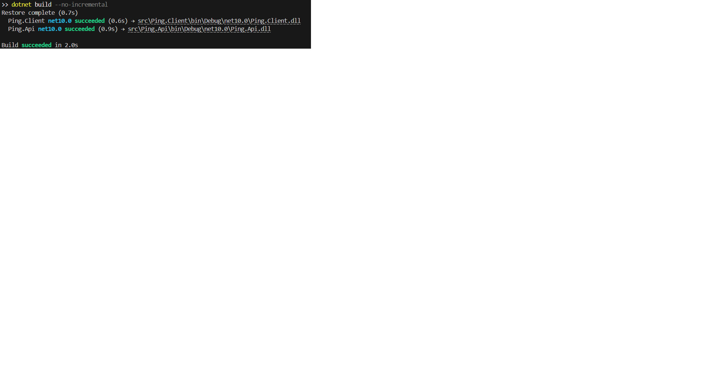
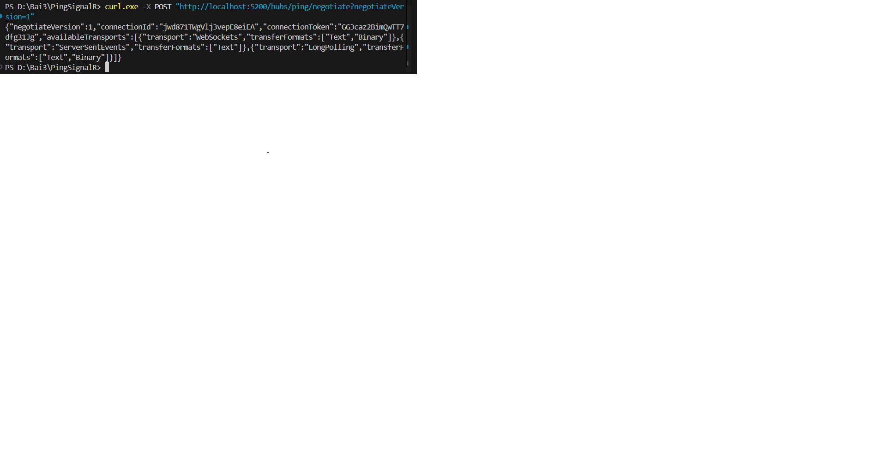
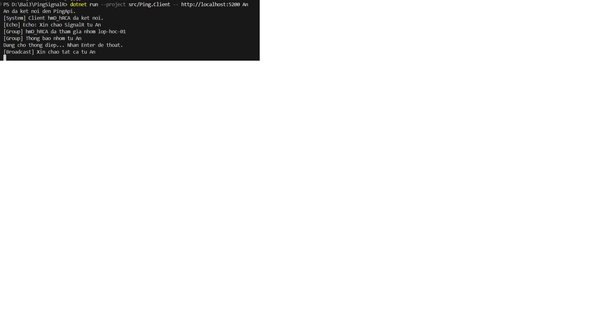
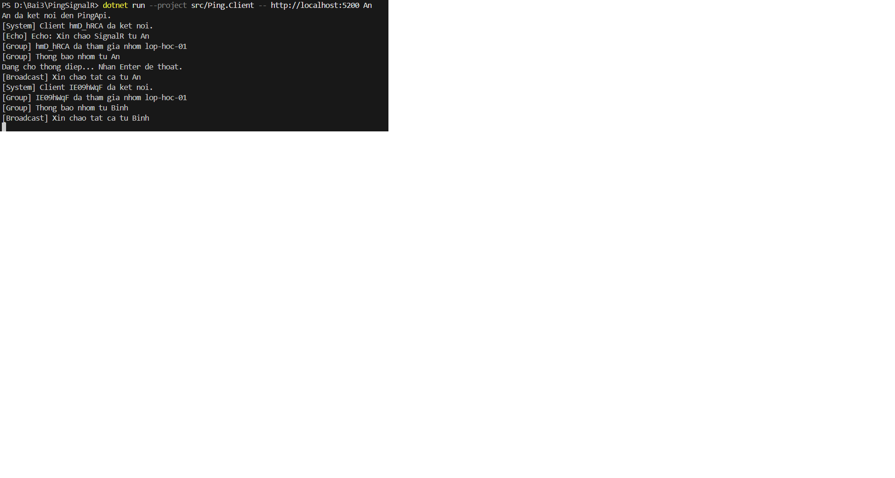
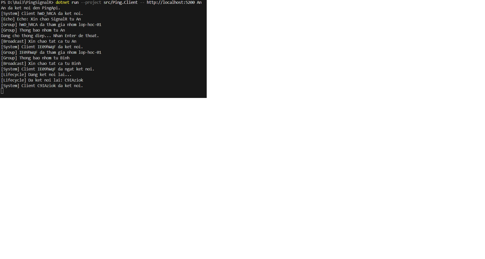
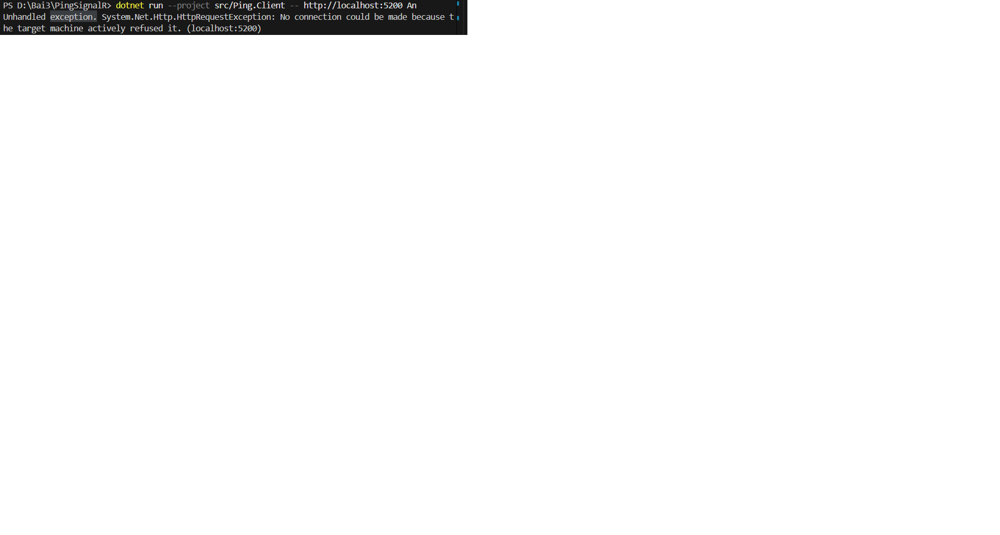
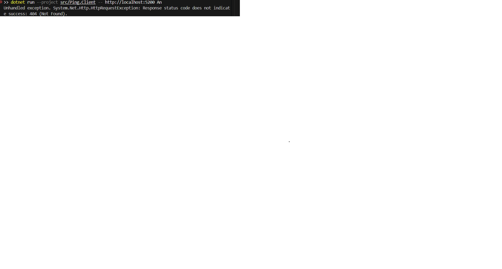
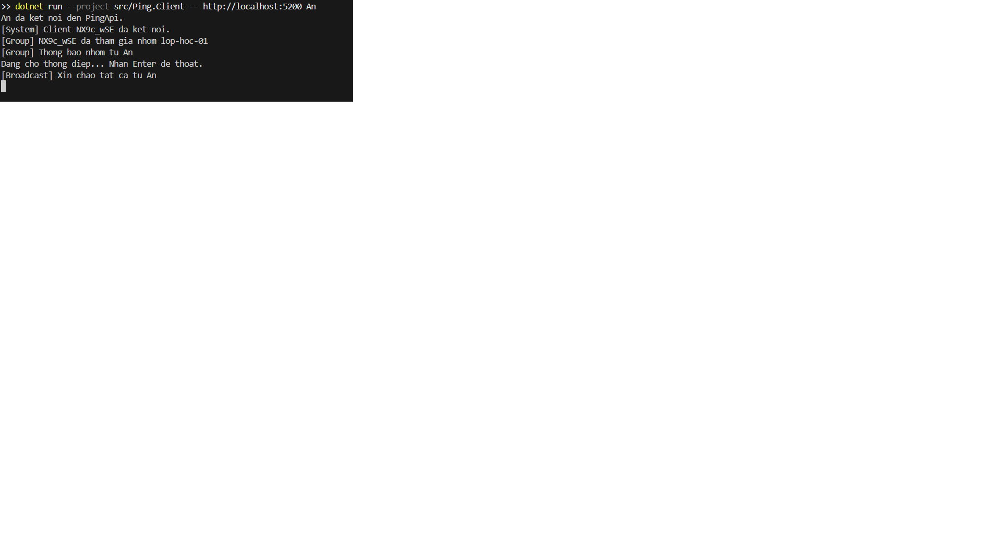
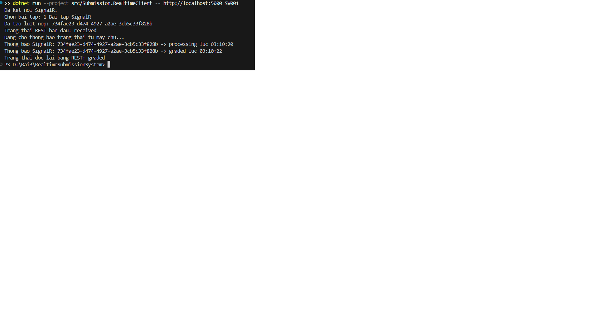

# Bài 3: Giao tiếp thời gian thực với SignalR (.NET 10)

## 1. Minh chứng thực hành PingSignalR
### Bước 1: Tạo solution và biên dịch

### Bước 2: Kiểm tra bắt tay negotiate

### Bước 3 - 4: Gọi Echo từ Client tới Hub

### Bước 5: Broadcast và Group
Client An nhận được thông điệp Group và Broadcast từ Bình, nhưng không nhận Echo riêng của Bình.

### Bước 6: Vòng đời kết nối và tự động nối lại
Khi tắt và bật lại máy chủ, client tự động nối lại với ConnectionId mới.

### Bước 7: Thí nghiệm 3 lỗi điển hình
1. **Tắt máy chủ trước khi chạy client:** Lỗi `HttpRequestException: Connection refused` ngay tại `StartAsync`.

2. **Sai đường dẫn `/hub/ping`:** Lỗi `404 Not Found` ngay ở bước `negotiate`.

3. **Sai tên sự kiện `EchoRespone`:** Không báo lỗi nhưng client không nhận được thông điệp (lỗi chiều xuống bị im lặng).

---

## 2. Minh chứng EduSubmit Realtime (RealtimeSubmissionSystem)
Client tạo lượt nộp qua REST (`received`), nhận thông báo đẩy `processing` -> `graded` qua SignalR và đọc chốt lại bằng REST.

---

## 3. Trả lời câu hỏi và bảng thí nghiệm
### Câu hỏi đầu giờ
1. **Máy chủ có chủ động báo cho máy khách được không?** Có, thông qua kết nối WebSocket lâu dài của SignalR (`Clients.Group(...).SendAsync` hoặc `IHubContext` từ luồng nền).
2. **REST và SignalR chia việc thế nào?** REST dùng để tạo và truy vấn tài nguyên (nguồn sự thật); SignalR dùng để đẩy thông báo thay đổi trạng thái phát sinh sau đó.
3. **Nếu đứt mạng đúng lúc máy chủ báo `graded` thì sao?** Thông điệp đẩy bị mất; `WithAutomaticReconnect()` nối lại kết nối mới và client gọi `GET /api/submissions/{id}` để lấy trạng thái cuối cùng.

### Bảng 5 thí nghiệm EduSubmit
| Tình huống | Dự đoán | Kết quả thật | Giải thích |
| :--- | :--- | :--- | :--- |
| 1. Chạy 2 client cùng lúc | Mỗi client chỉ nhận tin của mình | Đúng | Mỗi lượt nộp vào nhóm riêng `submission:{id}` |
| 2. Tắt server trước khi chạy | Báo lỗi kết nối | `Connection refused` | `WithAutomaticReconnect` chỉ nối lại kết nối đã mở |
| 3. Sai đường dẫn `/hub/submissions` | Báo lỗi 404 | `404 Not Found` | Endpoint hub không tồn tại ở bước `negotiate` |
| 4. Sai tên sự kiện `On` | Không nhận được tin | Hết giờ chờ 10s | Sai tên sự kiện khiến handler bị bỏ qua |
| 5. Gọi `WatchSubmission` muộn 4s | Lỡ thông báo đẩy | Hết giờ chờ nhưng REST vẫn ra `graded` | Nhóm chưa có thành viên lúc đẩy tin, REST giữ nguồn sự thật |
