# Bài 1 – Tổng quan hệ thống và MEP
Họ tên:Tạ Hoàng Anh             MSSV:DTC245200117              Lớp:CNTTK23D
 
## 1. Cài đặt
(ảnh chụp kết quả Bước 4)

 
## 2. MepDemo (Bước 7)

- Trả lời 3 câu hỏi; mỗi MEP 1 câu mô tả
Trả lời ba câu hỏi: 
MEP 3: Mỗi bài nộp sub-x được một worker xử lý. Các worker chia nhau chấm các bài nộp trong hàng đợi.
MEP 4: Một sự kiện được gửi tới cả 3 dịch vụ đã đăng ký: ScoreService, NotificationService và StatsService.
Mô tả 5 mô hình MEP
•	Request–response — Bên gửi gửi yêu cầu và chờ bên nhận trả lời.
•	One-way — Bên gửi gửi thông điệp rồi tiếp tục công việc mà không chờ phản hồi.
•	Queue-based — Công việc được đưa vào hàng đợi để các worker chia nhau xử lý.
•	Publish–subscribe — Khi một sự kiện được phát, tất cả dịch vụ đã đăng ký loại sự kiện đó đều nhận được.
•	Streaming — Dữ liệu được truyền thành nhiều phần liên tiếp, bên nhận có thể xử lý từng phần ngay khi nhận được.

 
## 3. BasicWebApi (Bước 8)
- Ảnh chụp REST Client: 200, 201, 400
+200:
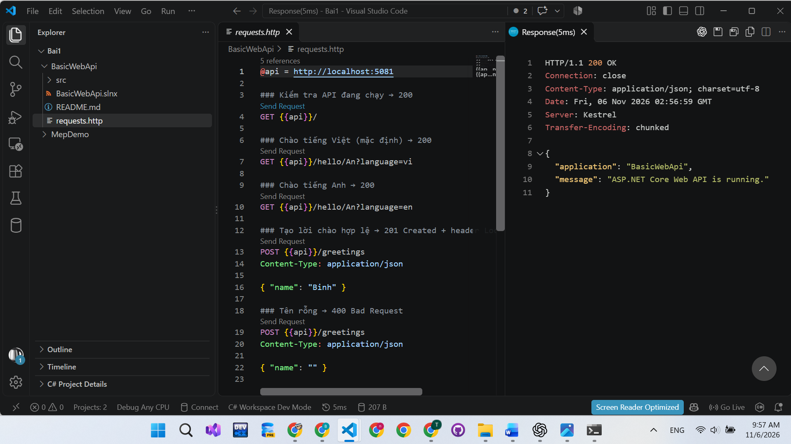

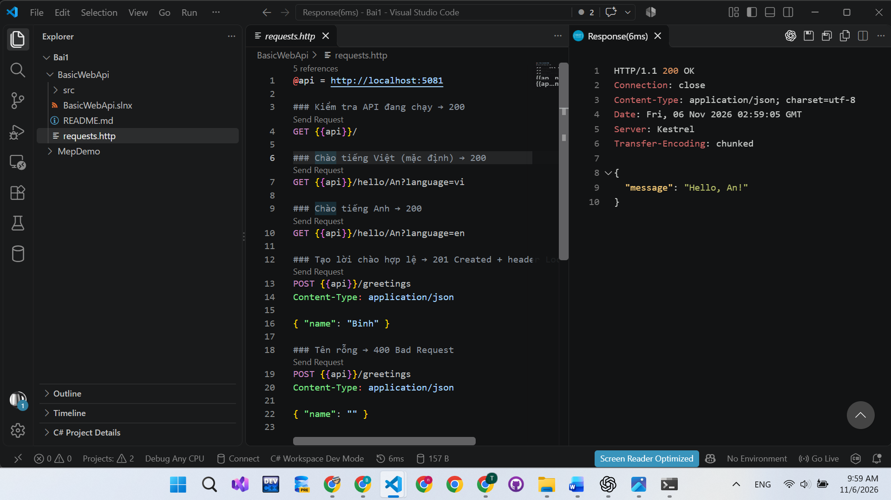
+201:
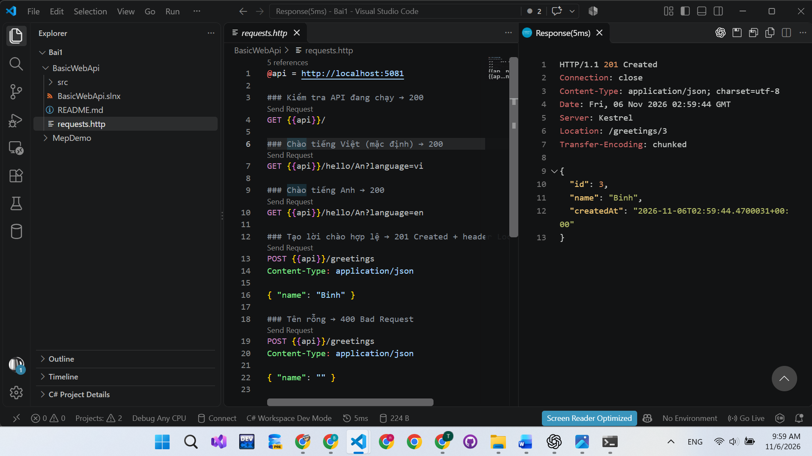
+400:
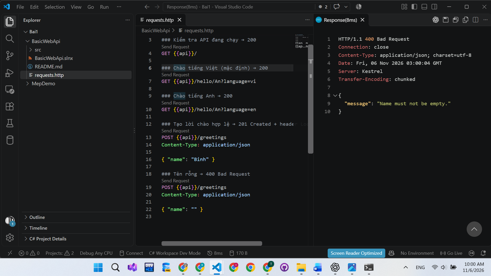
- Trả lời 3 câu hỏi mục 8.4
builder.Services.AddSingleton(...) phải đứng trước var app = builder.Build(); vì dịch vụ cần được đăng ký trước khi ứng dụng xây dựng bộ quản lý dịch vụ.

name lấy từ đường dẫn. Ví dụ, trong /hello/An?language=en, name có giá trị An. language lấy từ chuỗi truy vấn sau dấu ?, nên có giá trị en.

POST hợp lệ trả Results.Created với mã 201 vì yêu cầu đã tạo thành công một lời chào mới. Phản hồi còn có header Location chứa địa chỉ của lời chào vừa tạo.
 
## 4. MiniDistributedSystem (Bước 9)
- Ảnh chụp 2 terminal API + Client
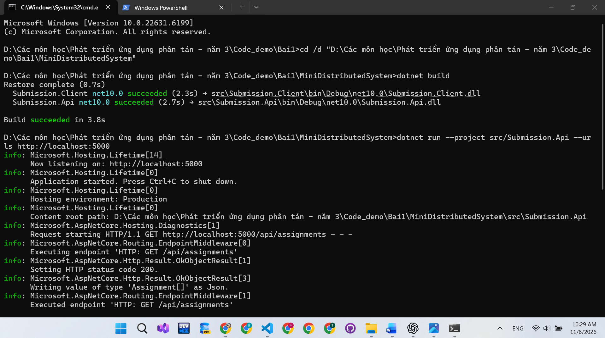
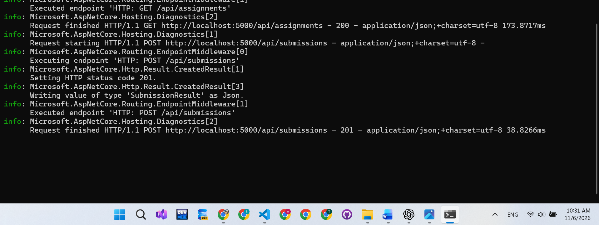
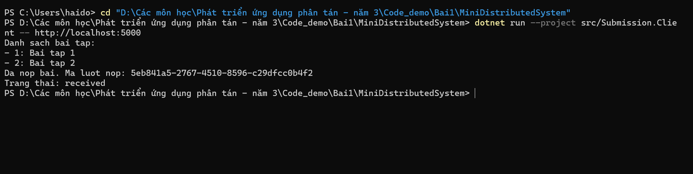
- Trả lời 3 câu hỏi
1. Client gọi hai endpoint của API:
- GET http://localhost:5000/api/assignments — Client yêu cầu danh sách bài tập. API trả 200 OK cùng danh sách bài tập.
- POST http://localhost:5000/api/submissions — Client gửi thông tin nộp bài. Với dữ liệu hợp lệ, API trả 201 Created cùng thông tin lượt nộp. Nếu dữ liệu không hợp lệ, API trả 400 Bad Request.
Mỗi lần gọi gồm một request từ Client và một response từ API.

2. Client không tham chiếu trực tiếp code của API. Hai bên thống nhất với nhau qua hợp đồng giao tiếp, gồm đường dẫn endpoint, phương thức HTTP và cấu trúc dữ liệu JSON. Client tự khai báo các record có cấu trúc tương ứng với dữ liệu API gửi và nhận.

3. Địa chỉ API được truyền qua tham số để có thể thay đổi máy chủ hoặc cổng khi chạy Client mà không cần sửa code. Nếu không truyền tham số, Client dùng mặc định http://localhost:5000. Dấu -- cho dotnet run biết phần sau là tham số truyền vào chương trình Client.
 
 
## 5. Thí nghiệm lỗi (Bước 10)
| # | Dự đoán | Thực tế | Đúng/Sai | Giải thích |
| --- | --- | --- | --- | --- |
| a | Client hiện thêm bài 3, không cần sửa code. | Client in đủ 3 bài, nộp bài thành công. | Đúng | API trả mảng JSON có thêm phần tử, Client đọc và duyệt danh sách theo hợp đồng dữ liệu. |
| b | Client báo lỗi kết nối khi API tắt. | HttpRequestException, kết nối bị từ chối (SocketException 10061). | Đúng | API không còn lắng nghe nên kết nối HTTP thất bại. Hàm trong cùng chương trình cũng có thể lỗi, nhưng không phụ thuộc kết nối mạng. |
| c | API trả 400, Client phát sinh lỗi. | API trả 400 Bad Request; EnsureSuccessStatusCode phát sinh HttpRequestException. | Đúng | Mã sinh viên rỗng không hợp lệ. Máy chủ phải tự kiểm tra dữ liệu nhận được từ Client. |
| d | Sai cổng gây lỗi; truyền đúng cổng giúp Client chạy. | Gọi 15000 bị từ chối; truyền 15050 thì Client nhận danh sách và nộp bài thành công. | Đúng | Địa chỉ API được truyền qua tham số dòng lệnh, nên có thể đổi cổng mà không sửa code. |

Thí nghiệm chạy trên bản sao dự án. Do cổng 5000 đang được sử dụng, dùng cổng 15000 và 15050 tương ứng với 5000 và 5050 trong hướng dẫn.

 
## 6. Dự án EduSubmit tự làm (Bước 11-12)
- Ảnh chụp kết quả; phần nào phải xem code mẫu?
- Luồng thông điệp:
  Client --(HTTP GET /api/assignments)--> Api   : request-response
  Client --(HTTP POST /api/submissions)--> Api  : ...
bước 11:
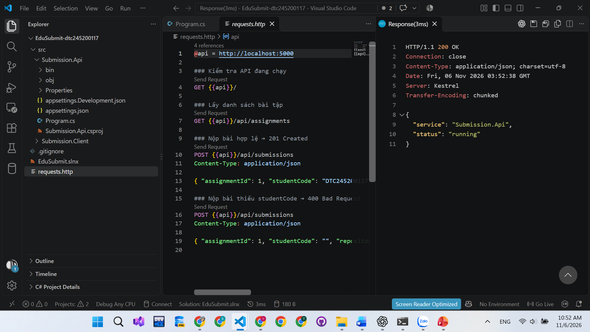
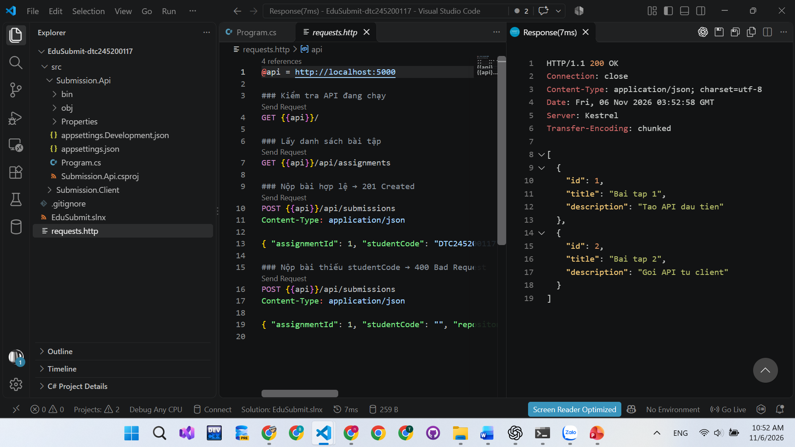
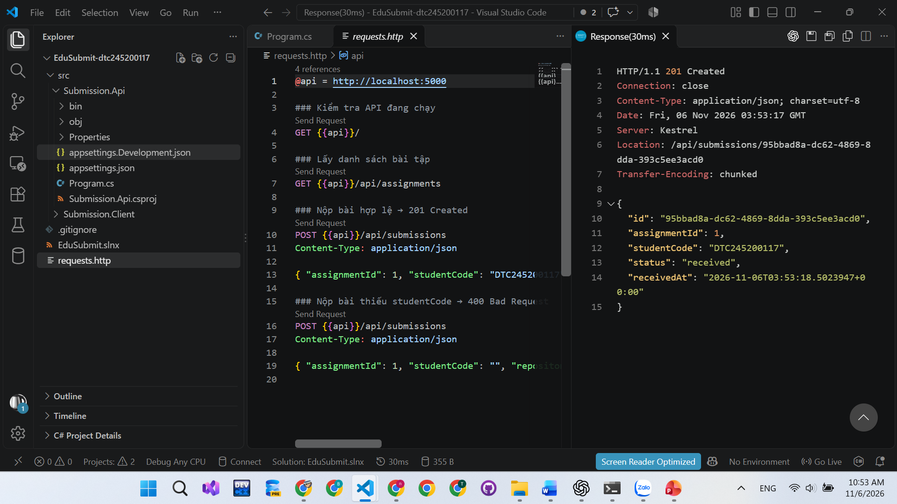
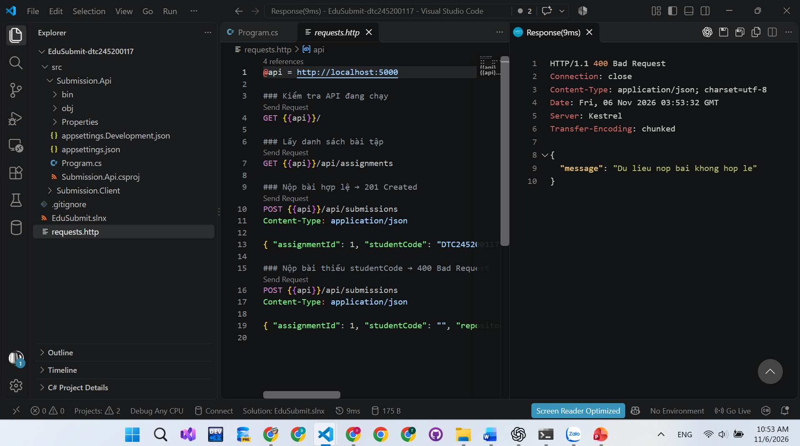
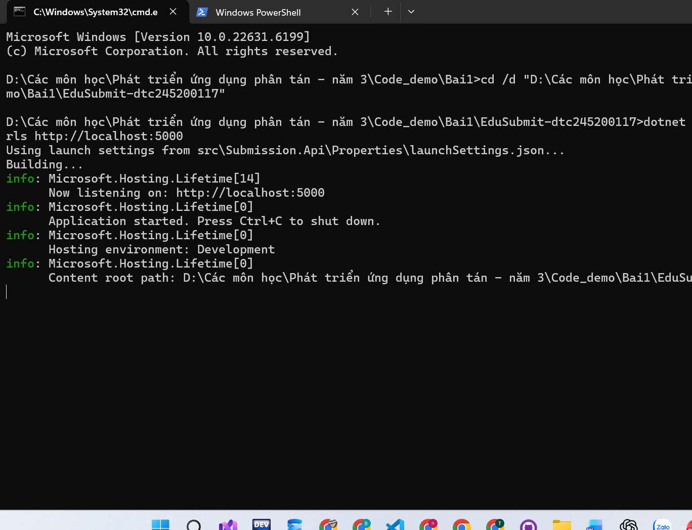
### Luồng thông điệp

- Client gửi `GET /api/assignments` đến API và nhận lại danh sách bài tập. Đây là mô hình request–response.
- Client gửi `POST /api/submissions` kèm thông tin bài nộp đến API và nhận lại mã lượt nộp cùng trạng thái `received`. Đây là mô hình request–response.

### Phần đã tham khảo

Tôi đã tham khảo cấu trúc và cách giao tiếp HTTP của dự án mẫu MiniDistributedSystem. Tôi được Codex hỗ trợ viết Submission.Client và hướng dẫn viết Submission.Api.

bước 12:

- API lưu lượt nộp trong danh sách và cho phép tra cứu theo ID.
- Đã kiểm tra POST trả 201, GET lượt nộp vừa tạo trả 200 và GET ID không tồn tại trả 404. Client đọc lại lượt nộp và in trạng thái received.
- Dữ liệu lưu trong bộ nhớ, sẽ mất khi API khởi động lại. Kiểm thử dùng cổng 18583.
- Codex hỗ trợ thực hiện Bước 12 và kiểm thử.

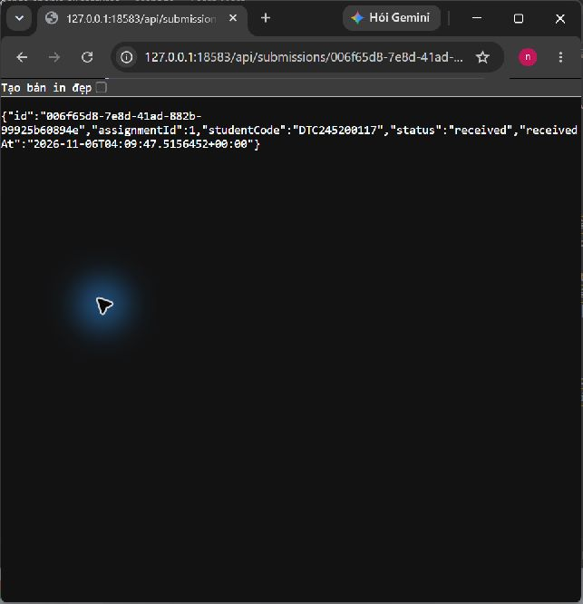

## 7. Khó khăn gặp phải và cách giải quyết
