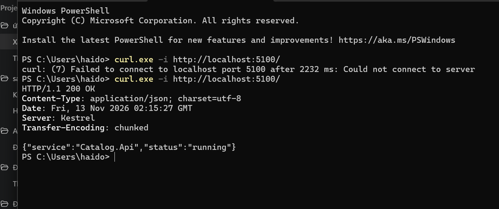
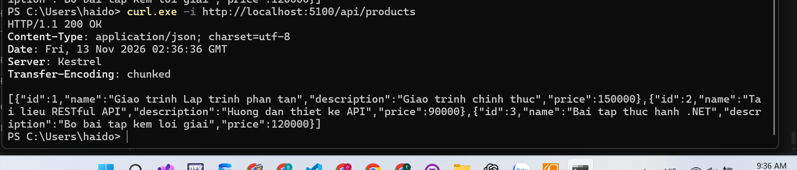
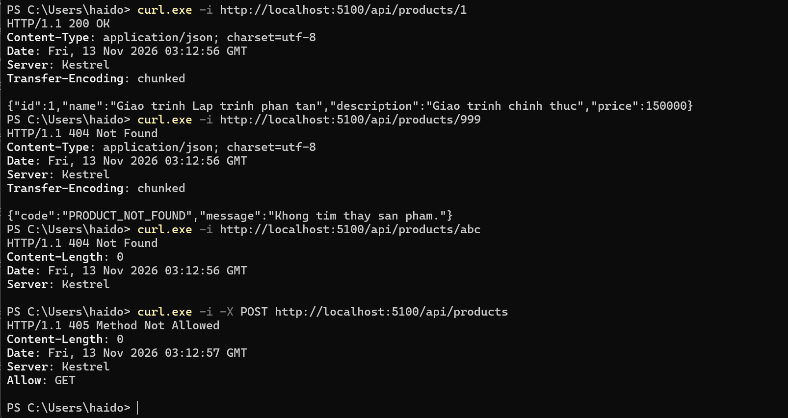
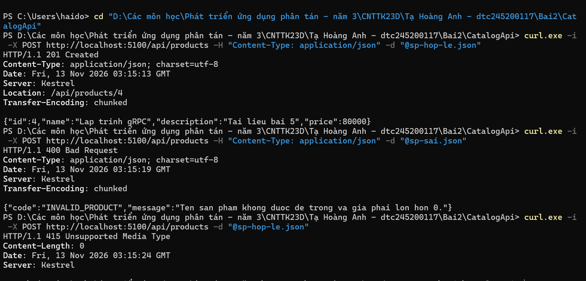
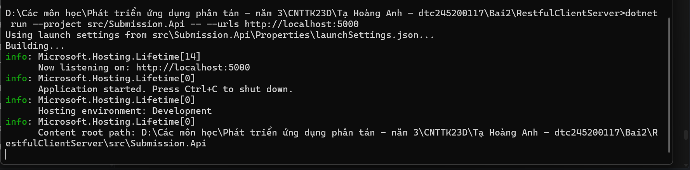
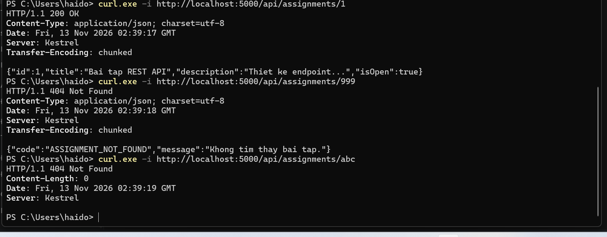
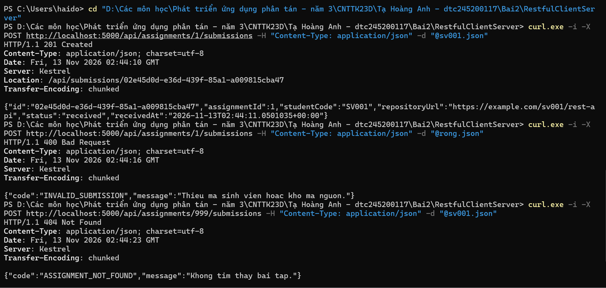
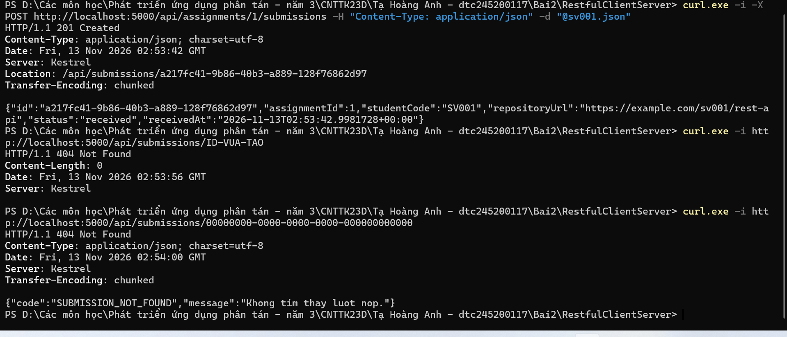
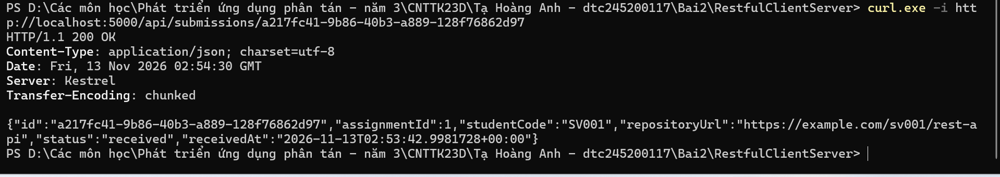
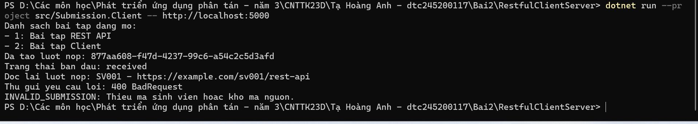

# Bài 2 — RESTful API

## Catalog

### Bước 2 — Chạy Catalog API và kiểm tra endpoint `/`

**Ảnh 1.** API trả về `200 OK` và thông tin trạng thái dưới dạng JSON.

### Bước 3 — Kiểm tra danh sách sản phẩm

**Ảnh 1.** Gọi `GET /api/products` trả về `200 OK` và danh sách 3 sản phẩm.

### Bước 4 — Xem chi tiết sản phẩm

**Ảnh 1.** Bốn ca kiểm tra lần lượt trả `200 OK`, `404 PRODUCT_NOT_FOUND`, `404` với body rỗng và `405 Method Not Allowed`.

### Bước 5 — Tạo sản phẩm

**Ảnh 1.** Tạo sản phẩm hợp lệ trả `201 Created` kèm `Location`, giá âm trả `400 INVALID_PRODUCT` và yêu cầu thiếu `Content-Type` JSON trả `415 Unsupported Media Type`.

## EduSubmit

### Bước 4 — Chạy API và kiểm tra chi tiết bài tập

**Ảnh 1.** Submission API đang chạy tại `http://localhost:5000`.

**Ảnh 2.** Kiểm tra bài tập có ID `1`, ID `999` không tồn tại và ID `abc` không hợp lệ. Các kết quả lần lượt là `200 OK`, `404` kèm `ASSIGNMENT_NOT_FOUND` và `404` với body rỗng.

### Bước 5 — Nộp bài

**Ảnh 1.** Nộp bài hợp lệ trả `201 Created` và `Location`. Dữ liệu rỗng trả `400 INVALID_SUBMISSION`, còn bài tập không tồn tại trả `404 ASSIGNMENT_NOT_FOUND`.

### Bước 6 — Đọc lại lượt nộp

**Ảnh 1.** Tạo lượt nộp trả `201 Created` kèm `Location`. Gọi GUID không tồn tại trả `404 SUBMISSION_NOT_FOUND`. Ảnh cũng cho thấy yêu cầu với chuỗi `ID-VUA-TAO` trả `404` vì không khớp định dạng GUID.

**Ảnh 2.** Gọi đúng địa chỉ trong `Location` trả `200 OK` và thông tin lượt nộp.

### Bước 7 — Chạy máy khách

**Ảnh 1.** Máy khách liệt kê bài tập đang mở, tạo và đọc lại lượt nộp, rồi xử lý yêu cầu sai với `400 INVALID_SUBMISSION`.

### Bảng phá thử EduSubmit

| Ca | Yêu cầu | Kết quả mong đợi | Kết quả đã kiểm tra |
| --- | --- | --- | --- |
| 5a | POST bài tập 1 với `sv001.json` hợp lệ | `201 Created`, có `Location` | Đã kiểm tra, xem ảnh bước 5 |
| 5b | POST bài tập 1 với `rong.json` | `400 INVALID_SUBMISSION` | Đã kiểm tra, xem ảnh bước 5 |
| 5c | POST bài tập 999 | `404 ASSIGNMENT_NOT_FOUND` | Đã kiểm tra, xem ảnh bước 5 |
| 5d | POST thiếu header `Content-Type` | `415 Unsupported Media Type` | Chưa kiểm tra |
| 5e | POST body JSON sai cú pháp | `400 Bad Request` | Chưa kiểm tra |
| 5f | POST body thiếu `repositoryUrl` | `400 INVALID_SUBMISSION` | Chưa kiểm tra |
| 5g | PUT `/api/assignments/1` | `405 Method Not Allowed` | Chưa kiểm tra |
| 5h | POST vào bài tập đã đóng | `400 ASSIGNMENT_CLOSED` | Chưa kiểm tra, cần dữ liệu bài tập có `IsOpen = false` |
| 6a | GET địa chỉ `Location` vừa tạo | `200 OK`, đúng lượt nộp | Đã kiểm tra, xem ảnh bước 6 |
| 6b | GET GUID chưa tồn tại | `404 SUBMISSION_NOT_FOUND` | Đã kiểm tra, xem ảnh bước 6 |
| 6c | Khởi động lại API rồi GET lượt nộp cũ | `404 SUBMISSION_NOT_FOUND` | Chưa kiểm tra |

### Ba câu hỏi giải thích

#### 1. Vì sao URI dùng danh từ, còn hành động do phương thức HTTP đảm nhận?

URI định danh tài nguyên mà máy khách muốn làm việc, còn phương thức HTTP thể hiện thao tác. Trong code, `assignments` là tập bài tập và `submissions` là tập lượt nộp. Ví dụ `GET /api/assignments/1` đọc bài tập số 1, còn `POST /api/assignments/1/submissions` tạo lượt nộp thuộc bài tập đó.

#### 2. “Stateless” thể hiện ở đâu trong code đã viết?

Mỗi yêu cầu tự mang thông tin cần thiết để API xử lý. Với `POST /api/assignments/1/submissions`, mã bài tập nằm trong URI, còn `studentCode` và `repositoryUrl` nằm trong body. Máy chủ xử lý dựa trên yêu cầu hiện tại, không cần nhớ phiên làm việc của máy khách từ lần gọi trước. Danh sách bài tập và lượt nộp vẫn được lưu trong bộ nhớ máy chủ.

#### 3. Vì sao client và server mỗi bên khai báo DTO riêng mà vẫn khớp nhau?

Hai bên trao đổi thông qua cấu trúc JSON đã thống nhất. Server và client mỗi bên khai báo `CreateSubmissionRequest` riêng với `StudentCode` và `RepositoryUrl`, tương ứng với các trường `studentCode` và `repositoryUrl` trong JSON. Hai project vì thế có thể phát triển độc lập, dựa trên cùng một hợp đồng dữ liệu.
