# Bài 3 – SignalR


## Bước 1.1 – Tạo solution và hai project PingSignalR

Tạo solution `PingSignalR.slnx` trong thư mục `PingSignalR`.

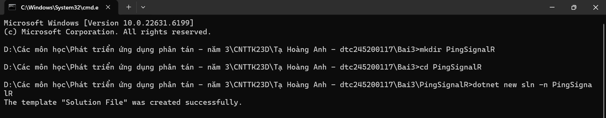

Tạo hai project `Ping.Api` và `Ping.Client`. Cả hai đều restore thành công. Ảnh chụp lần chạy từ thư mục `Bai3`. Sau đó hai project được chuyển vào `PingSignalR/src` theo cấu trúc của slide.

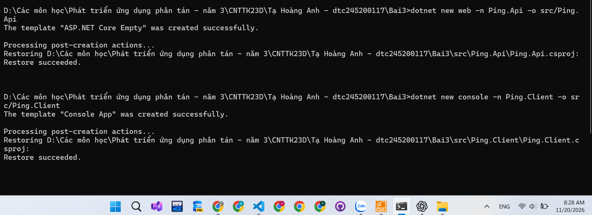

## Bước 1.2 – Thêm project vào solution và build

- Đã thêm Ping.Api và Ping.Client vào solution.
- Đã thêm gói Microsoft.AspNetCore.SignalR.Client phiên bản 10.0.15 cho Ping.Client và tạo .gitignore.
- Build thành công với 0 Warning(s), 0 Error(s). Lệnh kiểm tra là `dotnet build --no-restore` sau khi đã restore gói từ nuget.org.


## Bước 2 – Đăng ký SignalR và kiểm tra negotiate

Máy chủ đăng ký SignalR và ánh xạ PingHub tới /hubs/ping. Build thành công với 0 lỗi.

POST /hubs/ping/negotiate?negotiateVersion=1 trả về connectionId và ba phương thức WebSockets, ServerSentEvents, LongPolling. GET /hubs/ping khi thiếu connectionId trả về 400.

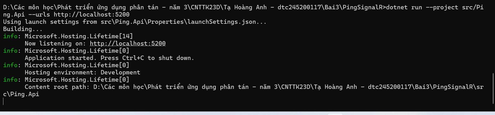


## Bước 3 – Phản hồi Echo cho máy khách đã gọi

Khi máy khách gọi `Echo`, hub gửi sự kiện `EchoResponse` với nội dung `Echo: <tin nhắn>` qua `Clients.Caller`. Phản hồi chỉ đến kết nối đã gọi.

Build thành công với 0 cảnh báo và 0 lỗi. Kiểm tra qua kết nối SignalR cục bộ nhận được `Echo: Xin chao SignalR`.


## Bước 4 – Kết nối máy khách và gọi Echo

Máy khách đăng ký nhận `EchoResponse`, mở kết nối tới `/hubs/ping` rồi gọi `Echo` bằng `InvokeAsync`. Khi chạy hai tiến trình, Terminal 1 giữ máy chủ `Ping.Api` ở cổng `5200`. Tại thư mục `Bai3/PingSignalR`, Terminal 2 chạy:

```cmd
dotnet run --project src/Ping.Client -- http://localhost:5200 An
```

Build thành công với 0 cảnh báo và 0 lỗi. Máy khách in `[Echo] Echo: Xin chao SignalR tu An`.

| Thử nghiệm | Kết quả quan sát |
| --- | --- |
| Gọi `Ech0` thay cho `Echo` | `HubException` báo `Method does not exist`. |
| Đăng ký `EchoRespone` thay cho `EchoResponse` | Máy khách kết nối và tiếp tục chờ, nhưng dòng `[Echo]` không xuất hiện. |


## Bước 5 – Phát rộng và gửi theo nhóm

`Echo` dùng `Clients.Caller` để trả lời kết nối đã gọi. `SendToGroup` dùng `Clients.Group` để gửi đến các thành viên, còn `Broadcast` dùng `Clients.All` để gửi đến mọi kết nối đang mở. `JoinGroup` thêm kết nối vào nhóm rồi báo cho nhóm biết.

Chạy theo thứ tự dưới đây, từ thư mục `Bai3/PingSignalR`:

| Terminal | Lệnh |
| --- | --- |
| 1 – Máy chủ | `dotnet run --project src/Ping.Api --urls http://localhost:5200` |
| 2 – An | `dotnet run --project src/Ping.Client -- http://localhost:5200 An` |
| 3 – Bình | `dotnet run --project src/Ping.Client -- http://localhost:5200 Binh` |

Build thành công với 0 cảnh báo và 0 lỗi. Trong lần kiểm tra hai máy khách, An nhận `[Group] Thong bao nhom tu Binh` và `[Broadcast] Xin chao tat ca tu Binh`. Echo của Bình chỉ hiện ở cửa sổ Bình. Bình vào sau nên các tin An gửi trước đó không xuất hiện ở cửa sổ Bình.

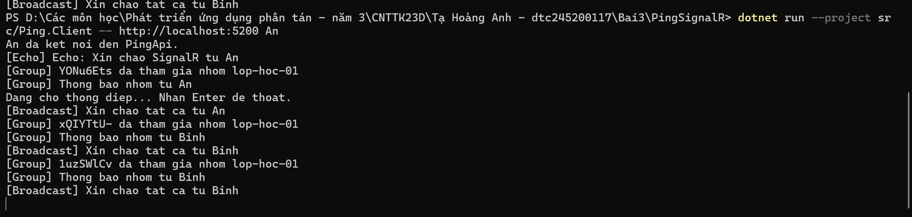

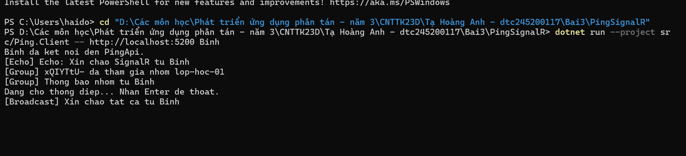

## Bước 6 – Vòng đời kết nối và tự kết nối lại

`PingHub` ghi nhật ký `[Hub]` và gửi `SystemMessage` khi máy khách kết nối hoặc ngắt kết nối. Máy khách đăng ký `Reconnecting`, `Reconnected` và `Closed` trước `StartAsync` để hiển thị trạng thái kết nối.

Build thành công với 0 cảnh báo và 0 lỗi. Khi dừng rồi chạy lại máy chủ trên cổng thử nghiệm, Terminal 2 của An in `[Lifecycle] Dang ket noi lai...` và `[Lifecycle] Da ket noi lai: ...`. `ConnectionId` sau khi nối lại khác với ID ban đầu.

`WithAutomaticReconnect()` dùng các khoảng chờ mặc định 0, 2, 10 và 30 giây giữa các lần thử. Sau khi nối lại, máy khách phải gọi `JoinGroup` nếu muốn tham gia lại nhóm vì tư cách thành viên gắn với kết nối cũ. Các tin gửi khi máy khách mất kết nối sẽ không được phát lại.

Để tái hiện, chạy máy chủ ở Terminal 1 và An ở Terminal 2 như Bước 5. Nhấn Ctrl+C tại Terminal 1 rồi chạy lại máy chủ trên cổng `5200`. Giữ An chạy để thấy cả hai dòng `[Lifecycle]`.

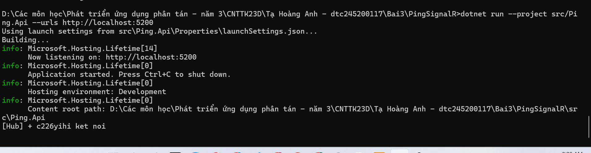

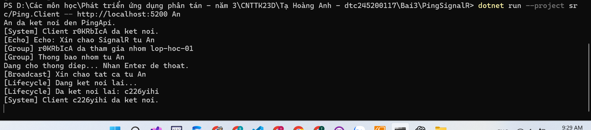

## Bước 7 – Ba thí nghiệm lỗi kết nối

| Ca | Thao tác | Kết quả quan sát | Giải thích |
| --- | --- | --- | --- |
| 1. Máy chủ chưa chạy | Chạy `Ping.Client` khi `Ping.Api` đã dừng. | `HttpRequestException` báo kết nối bị từ chối. | `StartAsync()` thất bại khi mở kết nối lần đầu. `WithAutomaticReconnect()` áp dụng sau khi đã kết nối thành công. |
| 2. Sai đường dẫn hub | Chạy bản client thử nghiệm dùng `/hub/ping` khi máy chủ vẫn ánh xạ `/hubs/ping`. | `HttpRequestException` báo `404 (Not Found)`. | Yêu cầu negotiate đi đến đường dẫn thiếu chữ `s`. |
| 3. Sai tên thông điệp | Chạy bản client thử nghiệm đăng ký `EchoRespone` trong khi hub gửi `EchoResponse`. | Client kết nối, nhận tin nhóm và tin phát rộng. Dòng `[Echo]` không xuất hiện và ứng dụng tiếp tục chờ. | Máy khách chỉ gọi hàm xử lý khi tên sự kiện khớp với tên hub gửi. |

Cả solution build thành công với 0 cảnh báo và 0 lỗi. Hai biến thể được chạy từ bản sao tạm. Chạy lại client gốc cho kết quả `[Echo] Echo: Xin chao SignalR tu An`.

| Phạm vi gửi | Ai nhận | Ví dụ trong EduSubmit |
| --- | --- | --- |
| `Clients.All` | Mọi kết nối đang mở | Thông báo có bài tập mới. |
| `Clients.Caller` | Kết nối vừa gọi hub | Xác nhận yêu cầu đăng ký theo dõi lượt nộp. |
| `Clients.Group(name)` | Thành viên của nhóm | Gửi trạng thái lượt nộp đến nhóm `submission:{id}`. |
| `Clients.Client(id)` | Kết nối mang đúng `ConnectionId` | Gửi thông báo riêng tới một phiên làm việc. |

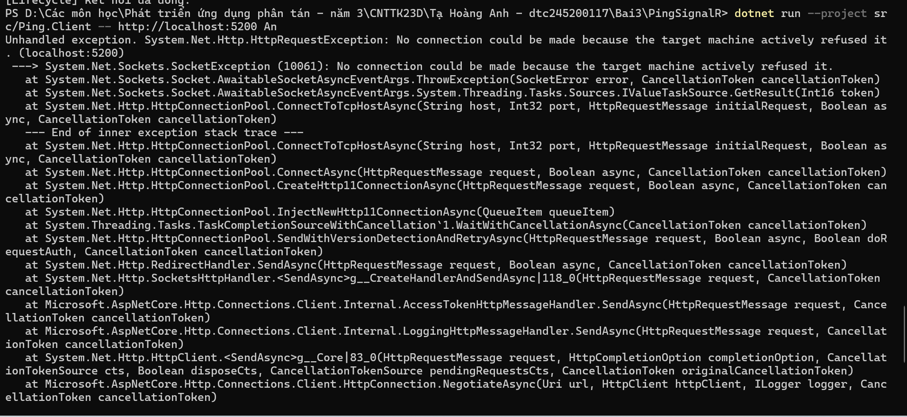

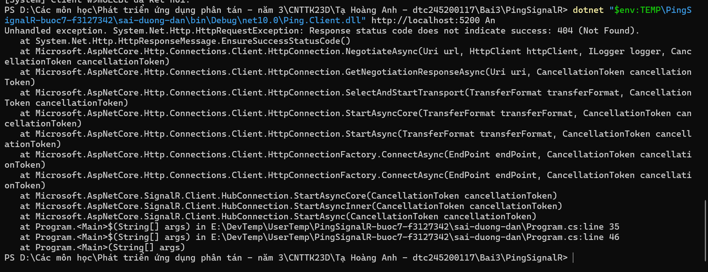

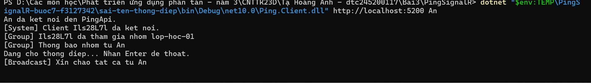

## EduSubmit realtime

### Bước 1 – Tạo solution và hai project

Tạo `RealtimeSubmissionSystem.slnx` với máy chủ `Submission.RealtimeApi` và máy khách `Submission.RealtimeClient`. Thêm gói `Microsoft.AspNetCore.SignalR.Client` phiên bản `10.0.15` cho máy khách và tạo `.gitignore`.

Chạy `dotnet build --tl:off` trong thư mục `Bai3/RealtimeSubmissionSystem`. Cả hai project build thành công với 0 cảnh báo và 0 lỗi.

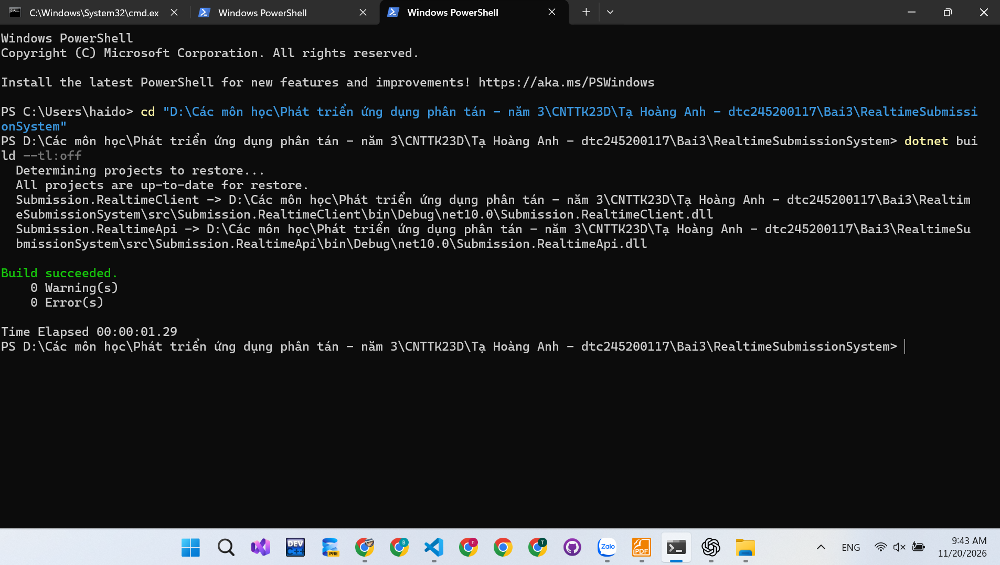

### Bước 2 – REST API và thời điểm cập nhật

Giữ các endpoint và mã lỗi của EduSubmit Bài 2. Danh sách lượt nộp dùng chung khóa `submissionsLock` khi đọc, ghi hoặc xóa. Một lượt nộp mới có trạng thái `received` và dùng cùng thời điểm UTC cho `ReceivedAt` và `UpdatedAt`.

Build thành công với 0 lỗi. POST hợp lệ trả `201 Created`, có `Location`, `status: received` và `updatedAt`. GET theo `Location` trả `200 OK`. Bài tập không tồn tại trả `404`. Bài tập đã đóng và dữ liệu thiếu đều trả `400` với mã lỗi tương ứng.

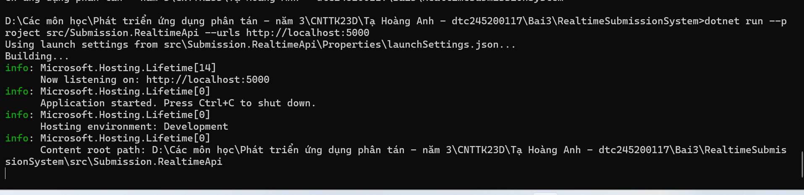

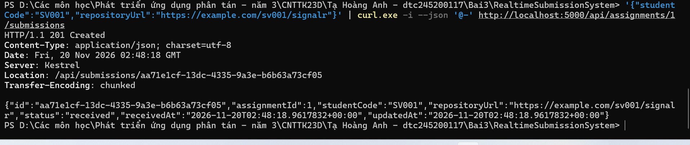

### Bước 3 – SubmissionHub và nhóm theo lượt nộp

Đăng ký SignalR trước `builder.Build()` và ánh xạ `SubmissionHub` tại `/hubs/submissions`. Sau khi có ID từ REST, máy khách có thể gọi `WatchSubmission(id)` để đưa kết nối hiện tại vào nhóm `submission:{id}`. `SubmissionGroups` tạo tên nhóm theo cùng quy ước cho ID dạng `Guid` hoặc chuỗi.

Build thành công với 0 lỗi. POST negotiate tại `/hubs/submissions/negotiate` trả `connectionId`. Cùng yêu cầu gửi đến `/hub/submissions/negotiate` trả `404 Not Found`. REST `GET /api/assignments` vẫn trả `200 OK`.

Gửi theo nhóm giới hạn thông báo trạng thái đến các kết nối đang theo dõi lượt nộp. Điều này giúp hạn chế chia sẻ dữ liệu sang các kết nối ngoài nhóm và giảm số bản tin phải truyền.

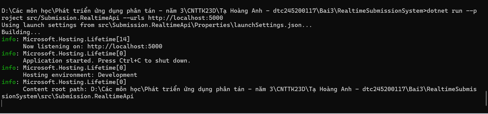

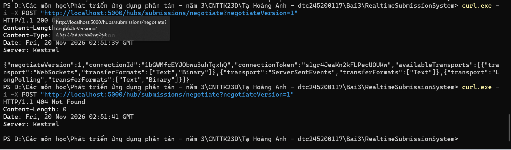

### Bước 4 – Chấm bài ở nền và gửi trạng thái qua SignalR

POST trả `201 Created` với trạng thái `received` rồi tác vụ nền tiếp tục chấm bài. Sau khoảng 1 giây, trạng thái chuyển sang `processing`, rồi chuyển sang `graded` khoảng 2 giây sau đó.

Máy chủ cập nhật trạng thái và `UpdatedAt` dưới khóa `submissionsLock` trước khi gửi `SubmissionStatusChanged` qua `IHubContext` đến nhóm `submission:{id}`. Thông báo chứa ba trường `SubmissionId`, `Status` và `UpdatedAt`. Lỗi gửi thông báo được ghi vào log để tác vụ vẫn cập nhật trạng thái tiếp theo.

Build thành công với 0 lỗi. Ba lần GET theo `Location` lần lượt trả `received`, `processing` và `graded` với `updatedAt` tăng dần. Máy khách theo dõi nhận được hai thông báo, với trạng thái và thời điểm khớp kết quả REST.

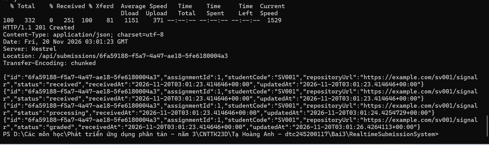

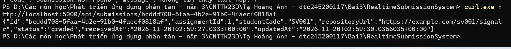
