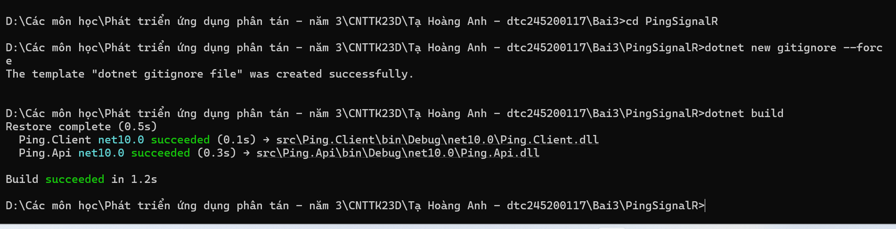
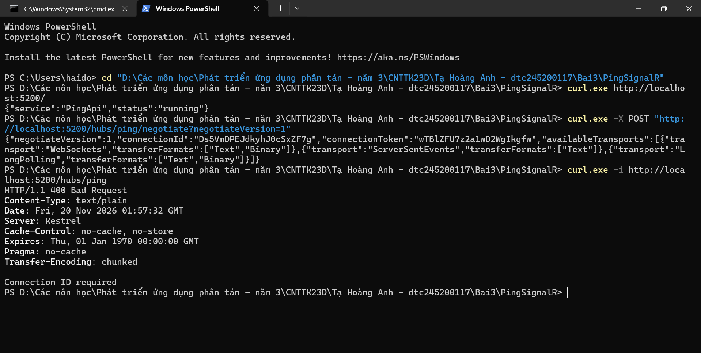

# Bài 3 – SignalR

## Bước 1.1 – Tạo solution và hai project PingSignalR

Tạo solution `PingSignalR.slnx` trong thư mục `PingSignalR`.

Tạo hai project `Ping.Api` và `Ping.Client`. Cả hai đều restore thành công. Ảnh chụp lần chạy từ thư mục `Bai3`. Sau đó hai project được chuyển vào `PingSignalR/src` theo cấu trúc của slide.

## Bước 1.2 – Thêm project vào solution và build

- Đã thêm Ping.Api và Ping.Client vào solution.
- Đã thêm gói Microsoft.AspNetCore.SignalR.Client phiên bản 10.0.15 cho Ping.Client và tạo .gitignore.
- Build thành công với 0 Warning(s), 0 Error(s). Lệnh kiểm tra là `dotnet build --no-restore` sau khi đã restore gói từ nuget.org.

## Bước 2 – Đăng ký SignalR và kiểm tra negotiate

Máy chủ đăng ký SignalR và ánh xạ PingHub tới /hubs/ping. Build thành công với 0 lỗi.

POST /hubs/ping/negotiate?negotiateVersion=1 trả về connectionId và ba phương thức WebSockets, ServerSentEvents, LongPolling. GET /hubs/ping khi thiếu connectionId trả về 400.

