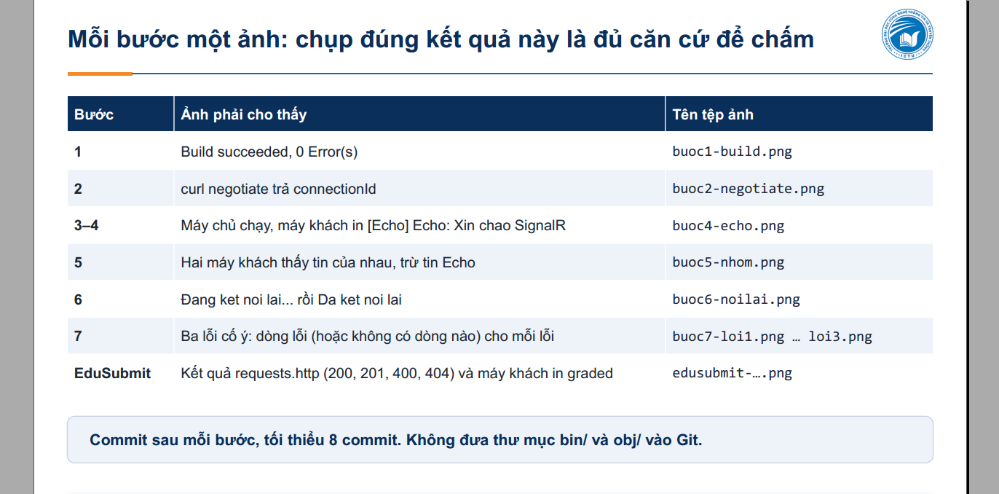
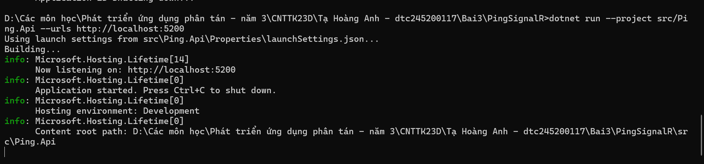
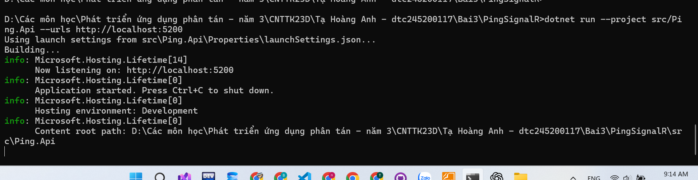
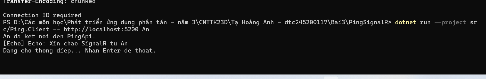

# Bài 3 – SignalR



## Bước 1.1 – Tạo solution và hai project PingSignalR

Tạo solution `PingSignalR.slnx` trong thư mục `PingSignalR`.


Tạo hai project `Ping.Api` và `Ping.Client`. Cả hai đều restore thành công. Ảnh chụp lần chạy từ thư mục `Bai3`. Sau đó hai project được chuyển vào `PingSignalR/src` theo cấu trúc của slide.


## Bước 1.2 – Thêm project vào solution và build

- Đã thêm Ping.Api và Ping.Client vào solution.
- Đã thêm gói Microsoft.AspNetCore.SignalR.Client phiên bản 10.0.15 cho Ping.Client và tạo .gitignore.
- Build thành công với 0 Warning(s), 0 Error(s). Lệnh kiểm tra là `dotnet build --no-restore` sau khi đã restore gói từ nuget.org.


## Bước 2 – Đăng ký SignalR và kiểm tra negotiate

Máy chủ đăng ký SignalR và ánh xạ PingHub tới /hubs/ping. Build thành công với 0 lỗi.

POST /hubs/ping/negotiate?negotiateVersion=1 trả về connectionId và ba phương thức WebSockets, ServerSentEvents, LongPolling. GET /hubs/ping khi thiếu connectionId trả về 400.


## Bước 3 – Phản hồi Echo cho máy khách đã gọi

Khi máy khách gọi `Echo`, hub gửi sự kiện `EchoResponse` với nội dung `Echo: <tin nhắn>` qua `Clients.Caller`. Phản hồi chỉ đến kết nối đã gọi.

Build thành công với 0 cảnh báo và 0 lỗi. Kiểm tra qua kết nối SignalR cục bộ nhận được `Echo: Xin chao SignalR`.



## Bước 4 – Kết nối máy khách và gọi Echo

Máy khách đăng ký nhận `EchoResponse`, mở kết nối tới `/hubs/ping` rồi gọi `Echo` bằng `InvokeAsync`. Khi chạy hai tiến trình, Terminal 1 giữ máy chủ `Ping.Api` ở cổng `5200`. Tại thư mục `Bai3/PingSignalR`, Terminal 2 chạy:

```cmd
dotnet run --project src/Ping.Client -- http://localhost:5200 An
```

Build thành công với 0 cảnh báo và 0 lỗi. Máy khách in `[Echo] Echo: Xin chao SignalR tu An`.

| Thử nghiệm | Kết quả quan sát |
| --- | --- |
| Gọi `Ech0` thay cho `Echo` | `HubException` báo `Method does not exist`. |
| Đăng ký `EchoRespone` thay cho `EchoResponse` | Máy khách kết nối và tiếp tục chờ, nhưng dòng `[Echo]` không xuất hiện. |




