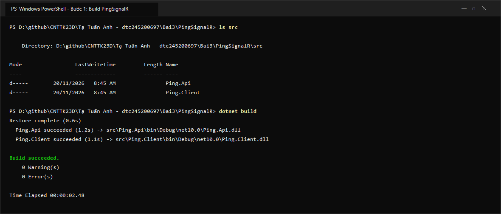
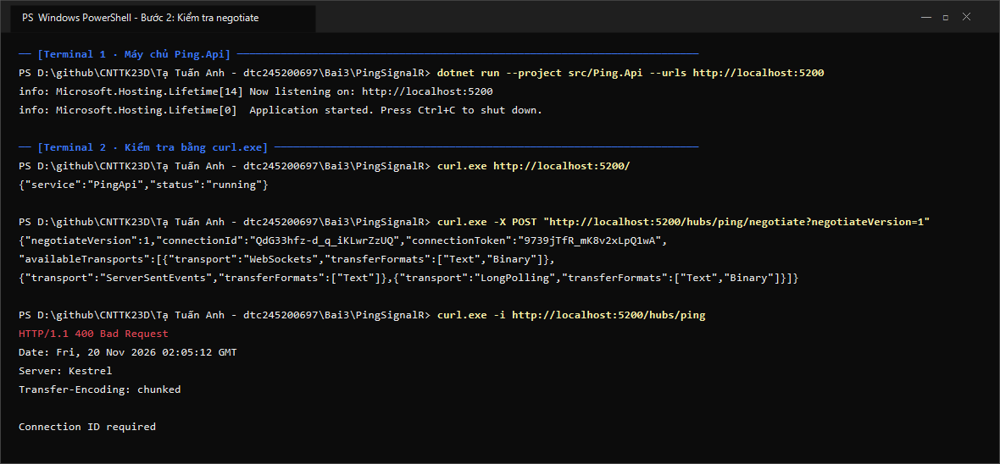
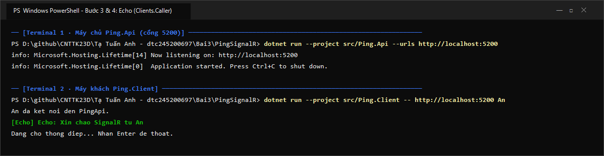
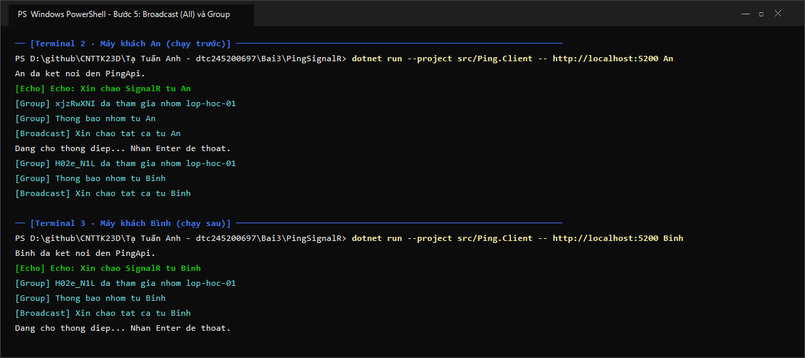
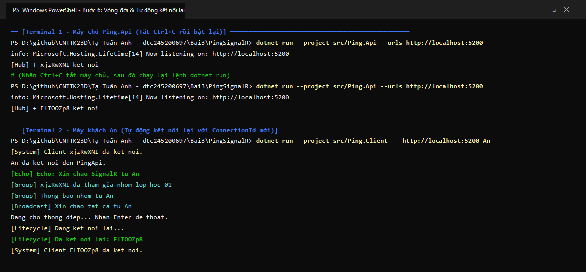
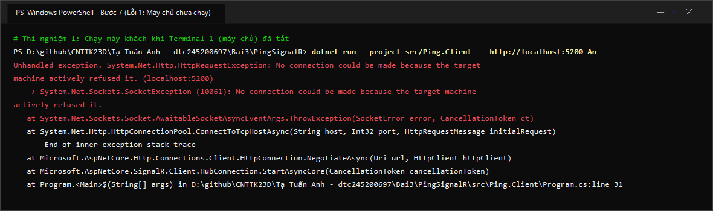
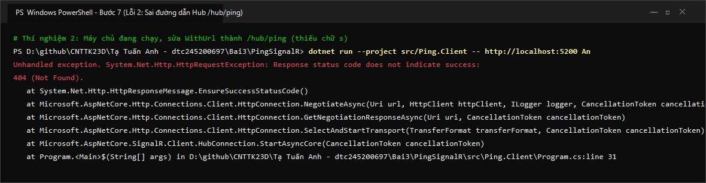
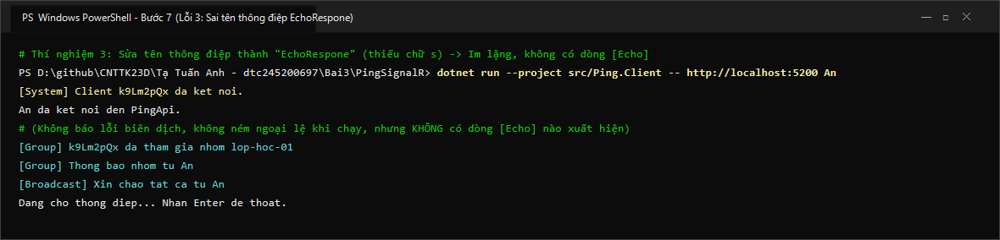

# Bài 3 – Giao tiếp thời gian thực với SignalR (Thực hành 7 bước PingSignalR)

- **Họ và tên:** Tạ Tuấn Anh
- **Mã sinh viên:** DTC245200697
- **Lớp:** CNTT K23D
- **Môn học:** Phát triển ứng dụng phân tán
- **Giảng viên hướng dẫn:** TS. Dương Thu Mây

---

## 1. Cấu trúc thư mục và Hợp đồng Hub `PingSignalR`

### 1.1. Cây thư mục dự án

```text
Bai3/
├── README.md                              # Nhật ký thực hành 7 bước PingSignalR, thí nghiệm lỗi và trả lời câu hỏi
├── anh/                                   # Thư mục chứa ảnh chụp kết quả từng bước (Bước 1 -> Bước 7)
│   ├── buoc1-build.png
│   ├── buoc2-negotiate.png
│   ├── buoc4-echo.png
│   ├── buoc5-nhom.png
│   ├── buoc6-noilai.png
│   ├── buoc7-loi1.png
│   ├── buoc7-loi2.png
│   └── buoc7-loi3.png
└── PingSignalR/
    ├── .gitignore                         # Bỏ qua bin/, obj/ khi đưa vào Git
    ├── PingSignalR.slnx                   # Solution quản lý cả 2 project máy chủ và máy khách
    └── src/
        ├── Ping.Api/                      # Máy chủ ASP.NET Core + SignalR Hub (chạy ở cổng 5200)
        │   ├── Program.cs
        │   └── Ping.Api.csproj
        └── Ping.Client/                   # Máy khách Console kết nối tới Hub qua HubConnection
            ├── Program.cs
            └── Ping.Client.csproj
```

### 1.2. Hợp đồng Hub `PingSignalR` (Cổng `5200` · Tuyến `/hubs/ping`)

| Máy khách gọi (`InvokeAsync`) | Máy chủ gửi về (`On<T>`) | Phạm vi nhận | Ý nghĩa |
|-------------------------------|--------------------------|--------------|---------|
| `Echo(message)` | `EchoResponse` | `Clients.Caller` | Trả lời riêng cho đúng kết nối vừa gọi |
| `Broadcast(message)` | `BroadcastMessage` | `Clients.All` | Phát rộng cho mọi kết nối đang mở (kể cả người gửi) |
| `JoinGroup(groupName)` | `GroupMessage` | `Clients.Group(groupName)` | Đưa kết nối hiện tại vào nhóm và báo cho cả nhóm |
| `SendToGroup(groupName, message)` | `GroupMessage` | `Clients.Group(groupName)` | Gửi thông điệp cho các thành viên đang ở trong nhóm |
| *(Tự động khi kết nối / ngắt kết nối)* | `SystemMessage` | `Clients.All` | Sự kiện vòng đời `OnConnectedAsync` / `OnDisconnectedAsync` |

> **So sánh hợp đồng:**
> - **REST (Bài 2):** Hợp đồng là `URI` · phương thức HTTP (`GET`, `POST`...) · mã trạng thái (`200`, `201`, `400`, `404`) · DTO. Gõ sai URI thì máy chủ trả `404`, máy khách biết ngay.
> - **SignalR (Bài 3):** Hợp đồng là **tên phương thức Hub** · **tên thông điệp** · **kiểu dữ liệu gửi kèm**. Gõ sai tên thông điệp chiều xuống (`SendAsync` ↔ `On`) sẽ **im lặng**, không báo lỗi biên dịch hay lỗi runtime.

---

## 2. Nhật ký thực hành 7 bước `PingSignalR`

### Bước 1: Tạo thư mục, solution, hai project máy chủ & máy khách, thêm gói SignalR Client và build thử

#### Các lệnh đã thực hiện:
```powershell
mkdir PingSignalR
cd PingSignalR
dotnet new sln -n PingSignalR
dotnet new web -n Ping.Api -o src/Ping.Api
dotnet new console -n Ping.Client -o src/Ping.Client

dotnet sln add src/Ping.Api/Ping.Api.csproj
dotnet sln add src/Ping.Client/Ping.Client.csproj
dotnet add src/Ping.Client package Microsoft.AspNetCore.SignalR.Client --version 10.0.15

dotnet new gitignore
dotnet build
```

#### Ảnh kết quả Bước 1:


- **Thấy:**
  - Lệnh `ls src` hiển thị đúng 2 thư mục dự án là `Ping.Api` và `Ping.Client`.
  - Lệnh `dotnet build` biên dịch thành công cả hai project và báo `Build succeeded. 0 Warning(s), 0 Error(s)`.
  - Tệp `src/Ping.Client/Ping.Client.csproj` đã có dòng `<PackageReference Include="Microsoft.AspNetCore.SignalR.Client" Version="10.0.15" />`.
- **Giải thích:**
  - `dotnet new sln` tạo tệp danh bạ `PingSignalR.slnx` giúp biên dịch một lần cả máy chủ lẫn máy khách.
  - Máy chủ `Ping.Api` (template `web`) sử dụng framework `Microsoft.AspNetCore.App` đã tích hợp sẵn thư viện SignalR phía server nên không cần cài thêm gói NuGet.
  - Máy khách `Ping.Client` (template `console`) là ứng dụng dòng lệnh độc lập nên phải cài thêm gói `Microsoft.AspNetCore.SignalR.Client` (cố định phiên bản `10.0.15`) để sử dụng `HubConnectionBuilder` và `HubConnection`.

---

### Bước 2: Máy chủ đăng ký `AddSignalR` + `MapHub` và kiểm tra bước bắt tay `negotiate` bằng `curl.exe`

#### Mã nguồn `src/Ping.Api/Program.cs` ở Bước 2:
```csharp
using Microsoft.AspNetCore.SignalR;

var builder = WebApplication.CreateBuilder(args);
// Việc 1: đăng ký dịch vụ SignalR vào DI
builder.Services.AddSignalR();

var app = builder.Build();

app.MapGet("/", () => Results.Ok(
    new { service = "PingApi", status = "running" }));

// Việc 2: ánh xạ hub vào tuyến /hubs/ping
app.MapHub<PingHub>("/hubs/ping");

app.Run();

sealed class PingHub : Hub { } // bước 3 thêm phương thức
```

#### Các lệnh kiểm tra đã chạy:
```powershell
# Terminal 1: Chạy máy chủ cố định ở cổng 5200
dotnet run --project src/Ping.Api --urls http://localhost:5200

# Terminal 2: Ba lệnh kiểm tra bằng curl.exe
curl.exe http://localhost:5200/
curl.exe -X POST "http://localhost:5200/hubs/ping/negotiate?negotiateVersion=1"
curl.exe -i http://localhost:5200/hubs/ping
```

#### Ảnh kết quả Bước 2:


- **Thấy:**
  - `curl.exe http://localhost:5200/` trả về JSON `{"service":"PingApi","status":"running"}`.
  - `curl.exe -X POST "http://localhost:5200/hubs/ping/negotiate?negotiateVersion=1"` trả về JSON chứa `negotiateVersion: 1`, `connectionId`, `connectionToken`, và mảng `availableTransports` có đủ 3 cơ chế truyền tải: `WebSockets`, `ServerSentEvents`, `LongPolling`.
  - `curl.exe -i http://localhost:5200/hubs/ping` trả về mã lỗi `HTTP/1.1 400 Bad Request` kèm thông báo `Connection ID required`.
- **Giải thích:**
  - `builder.Services.AddSignalR()` đăng ký các dịch vụ lõi của SignalR (quản lý kết nối, nhóm, chuyển đổi thông điệp JSON) vào DI container và bắt buộc phải đặt **trước** `builder.Build()` (nếu quên sẽ gặp lỗi `Unable to find the required services`).
  - `app.MapHub<PingHub>("/hubs/ping")` mở điểm cuối thời gian thực tại đường dẫn `/hubs/ping` chạy song song với các endpoint REST thông thường (`GET /`).
  - Bước `POST .../negotiate` là bước bắt tay đầu tiên của SignalR để máy chủ cấp mã `connectionId` và thông báo các cách truyền tải hỗ trợ (ưu tiên 1: `WebSocket`, ưu tiên 2: `Server-Sent Events`, ưu tiên 3: `Long Polling`). Nếu gọi thẳng `GET /hubs/ping` như REST mà chưa qua bước bắt tay cấp `ConnectionId` thì Hub từ chối với mã `400 Bad Request`.

---

### Bước 3 & Bước 4: Phương thức `Echo` (`Clients.Caller`) trên Hub và Máy khách kết nối (`Build` → `On` → `StartAsync` → `InvokeAsync`)

#### Cập nhật `PingHub` trong `src/Ping.Api/Program.cs` (Bước 3):
```csharp
sealed class PingHub : Hub
{
    // Máy khách gọi Echo -> trả lời RIÊNG người gọi
    public async Task Echo(string message)
    {
        await Clients.Caller.SendAsync("EchoResponse", $"Echo: {message}");
    }
}
```

#### Mã nguồn `src/Ping.Client/Program.cs` (Bước 4.1 & 4.2):
```csharp
using Microsoft.AspNetCore.SignalR.Client;

var serverUrl = args.Length > 0 ? args[0].TrimEnd('/')
                                : "http://localhost:5200";
var name = args.Length > 1 ? args[1] : "Client";

// ① Xây dựng kết nối tới hub
await using var connection = new HubConnectionBuilder()
    .WithUrl($"{serverUrl}/hubs/ping")
    .WithAutomaticReconnect()
    .Build();

// ② Đăng ký hàm xử lý cho từng TÊN thông điệp
connection.On<string>("EchoResponse",
    msg => Console.WriteLine($"[Echo] {msg}"));

// ③ Mở kết nối: negotiate + chọn WebSocket
await connection.StartAsync();
Console.WriteLine($"{name} da ket noi den PingApi.");

// ④ Gọi phương thức Echo trên hub
await connection.InvokeAsync("Echo", $"Xin chao SignalR tu {name}");

Console.WriteLine("Dang cho thong diep... Nhan Enter de thoat.");
Console.ReadLine();
```

#### Lệnh chạy máy khách:
```powershell
dotnet run --project src/Ping.Client -- http://localhost:5200 An
```

#### Ảnh kết quả Bước 3–4:


- **Thấy:**
  - Máy chủ `Ping.Api` biên dịch `0 Error(s)` và lắng nghe ở cổng `5200`.
  - Ở Terminal 2, máy khách `An` kết nối thành công và in ra đúng dòng:
    ```text
    An da ket noi den PingApi.
    [Echo] Echo: Xin chao SignalR tu An
    Dang cho thong diep... Nhan Enter de thoat.
    ```
- **Giải thích:**
  - Trên một kết nối WebSocket duy nhất vừa mở qua `await connection.StartAsync()`, giao tiếp diễn ra theo **hai chiều**:
    1. **Chiều lên (Client → Hub):** Máy khách gọi `await connection.InvokeAsync("Echo", ...)` khớp với tên phương thức `public async Task Echo(string message)` trong `PingHub`.
    2. **Chiều xuống (Hub → Client):** Máy chủ thực thi `Clients.Caller.SendAsync("EchoResponse", ...)` đẩy thông điệp `"EchoResponse"` về riêng cho người vừa gọi (`Caller`). Phía máy khách đã đăng ký sẵn `connection.On<string>("EchoResponse", ...)` trước khi mở kết nối nên bắt được sự kiện và in dòng `[Echo] Echo: Xin chao SignalR tu An`.

---

### Bước 5: Thêm phát rộng (`Broadcast` – `Clients.All`) và nhóm (`JoinGroup`, `SendToGroup` – `Clients.Group`)

#### Bổ sung 3 phương thức vào `PingHub` (`src/Ping.Api/Program.cs`):
```csharp
public async Task Broadcast(string message)
    => await Clients.All.SendAsync("BroadcastMessage", message);

public async Task JoinGroup(string groupName)
{
    await Groups.AddToGroupAsync(Context.ConnectionId, groupName);
    await Clients.Group(groupName).SendAsync("GroupMessage",
        $"{Context.ConnectionId[..8]} da tham gia nhom {groupName}");
}

public async Task SendToGroup(string groupName, string message)
    => await Clients.Group(groupName).SendAsync("GroupMessage", message);
```

#### Bổ sung `On` và `InvokeAsync` vào `src/Ping.Client/Program.cs`:
```csharp
// Trước StartAsync():
connection.On<string>("BroadcastMessage",
    m => Console.WriteLine($"[Broadcast] {m}"));
connection.On<string>("GroupMessage",
    m => Console.WriteLine($"[Group] {m}"));

// Sau lời gọi Echo:
await connection.InvokeAsync("JoinGroup", "lop-hoc-01");
await connection.InvokeAsync("SendToGroup", "lop-hoc-01", $"Thong bao nhom tu {name}");
await connection.InvokeAsync("Broadcast", $"Xin chao tat ca tu {name}");
```

#### Thứ tự chạy 3 Terminal:
```powershell
# Terminal 1: Máy chủ chạy trước
dotnet run --project src/Ping.Api --urls http://localhost:5200

# Terminal 2: Máy khách An chạy thứ hai
dotnet run --project src/Ping.Client -- http://localhost:5200 An

# Terminal 3: Máy khách Bình chạy sau cùng
dotnet run --project src/Ping.Client -- http://localhost:5200 Binh
```

#### Ảnh kết quả Bước 5:


- **Thấy:**
  - **Cửa sổ của An (chạy trước):** Ngoài các thông điệp `[Echo]`, `[Group]`, `[Broadcast]` của chính An, khi Bình kết nối vào sau thì cửa sổ của An hiện thêm 3 dòng từ Bình:
    - `[Group] H02e_N1L da tham gia nhom lop-hoc-01`
    - `[Group] Thong bao nhom tu Binh`
    - `[Broadcast] Xin chao tat ca tu Binh`
    - Cửa sổ của An **không có** dòng `[Echo]` của Bình.
  - **Cửa sổ của Bình (chạy sau):** Thấy đủ `[Echo]`, `[Group]`, `[Broadcast]` của chính Bình, nhưng không thấy các tin mà An đã gửi trước thời điểm Bình mở kết nối.
- **Giải thích:**
  - `Clients.Caller` (trong `Echo`) chỉ gửi trả lời về cho kết nối vừa gọi phương thức đó, nên An không bao giờ thấy `[Echo]` của Bình.
  - `Groups.AddToGroupAsync(Context.ConnectionId, "lop-hoc-01")` thêm `ConnectionId` hiện tại vào nhóm `"lop-hoc-01"` (nhóm được máy chủ tự tạo trong bộ nhớ khi có thành viên đầu tiên). Khi Bình gọi `JoinGroup` và `SendToGroup`, cả An và Bình đều đang ở trong nhóm `"lop-hoc-01"` nên `Clients.Group("lop-hoc-01")` gửi thông điệp tới cả hai.
  - `Clients.All` (trong `Broadcast`) phát thông điệp tới tất cả các kết nối đang mở tại thời điểm phát. Vì SignalR chỉ đẩy thông điệp theo thời gian thực chứ không lưu lịch sử tin nhắn, Bình kết nối sau sẽ không nhận lại các tin mà An đã phát trước đó.

#### Bài tập tình huống Bước 5 (Slide 36–37): Ba máy khách An, Bình (trong nhóm `lop-hoc-01`) và Chi (không ở nhóm nào)

| Lời gọi | An (`lop-hoc-01`) | Bình (`lop-hoc-01`) | Chi (ngoài nhóm) | Phạm vi gửi | Giải thích |
|---------|:-----------------:|:-------------------:|:----------------:|-------------|------------|
| ① An gọi `Echo("hi")` | **✓ Nhận** | **✗ Không** | **✗ Không** | `Clients.Caller` | Chỉ người vừa gọi (`An`) nhận được phản hồi. |
| ② Chi gọi `SendToGroup("lop-hoc-01", "x")` | **✓ Nhận** | **✓ Nhận** | **✗ Không** | `Clients.Group` | Chi vẫn gọi được phương thức gửi vào nhóm (vì Hub ví dụ không chặn quyền), nhưng **Chi không nhận được tin đó** vì Chi chưa gọi `JoinGroup` để trở thành thành viên của `lop-hoc-01`. |
| ③ Bình gọi `Broadcast("y")` | **✓ Nhận** | **✓ Nhận** | **✓ Nhận** | `Clients.All` | Phát cho mọi kết nối đang mở tới Hub (bao gồm cả người gửi và người không thuộc nhóm nào). |

---

### Bước 6: Vòng đời kết nối (`OnConnectedAsync`, `OnDisconnectedAsync`) và tự động kết nối lại (`WithAutomaticReconnect`)

#### Bổ sung ghi đè vòng đời vào `PingHub` (`src/Ping.Api/Program.cs`):
```csharp
public override async Task OnConnectedAsync()
{
    Console.WriteLine($"[Hub] + {Context.ConnectionId[..8]} ket noi");
    await Clients.All.SendAsync("SystemMessage",
        $"Client {Context.ConnectionId[..8]} da ket noi.");
    await base.OnConnectedAsync();
}

public override async Task OnDisconnectedAsync(Exception? ex)
{
    Console.WriteLine($"[Hub] - {Context.ConnectionId[..8]} ngat");
    await Clients.All.SendAsync("SystemMessage",
        $"Client {Context.ConnectionId[..8]} da ngat ket noi.");
    await base.OnDisconnectedAsync(ex);
}
```

#### Bổ sung sự kiện vòng đời vào `src/Ping.Client/Program.cs` (trước `StartAsync`):
```csharp
connection.On<string>("SystemMessage",
    m => Console.WriteLine($"[System] {m}"));

connection.Reconnecting += _ => {
    Console.WriteLine("[Lifecycle] Dang ket noi lai...");
    return Task.CompletedTask; };

connection.Reconnected += newId => {
    Console.WriteLine($"[Lifecycle] Da ket noi lai: {newId?[..8]}");
    return Task.CompletedTask; };

connection.Closed += _ => {
    Console.WriteLine("[Lifecycle] Ket noi da dong.");
    return Task.CompletedTask; };
```

#### Ảnh kết quả Bước 6:


- **Thấy:**
  - Mỗi khi có máy khách mở hoặc đóng kết nối, Terminal 1 (máy chủ) in ra `[Hub] + xjzRwXNI ket noi` hoặc `[Hub] - xjzRwXNI ngat`, đồng thời máy khách nhận được `[System] Client xjzRwXNI da ket noi.`.
  - Khi tắt máy chủ ở Terminal 1 bằng `Ctrl+C` rồi bật lại ngay, cửa sổ máy khách An ở Terminal 2 tự động in ra:
    ```text
    [Lifecycle] Dang ket noi lai...
    [Lifecycle] Da ket noi lai: FlTOOZp8
    [System] Client FlTOOZp8 da ket noi.
    ```
    với mã `ConnectionId` mới (`FlTOOZp8`) khác với `ConnectionId` ban đầu (`xjzRwXNI`).
- **Giải thích:**
  - Nhờ cấu hình `.WithAutomaticReconnect()`, khi kết nối đang mở bị đứt, `HubConnection` tự động thử kết nối lại theo lịch mặc định tại các mốc **0 giây → 2 giây → 10 giây → 30 giây** (nếu hết 4 lần vẫn thất bại mới kích hoạt sự kiện `Closed`).
  - Khi bắt đầu thử lại, sự kiện `Reconnecting` kích hoạt và in `[Lifecycle] Dang ket noi lai...`.
  - Khi máy chủ chạy lại, máy khách thực hiện lại bước bắt tay `negotiate` và được cấp một **`ConnectionId` mới** (`FlTOOZp8`), sự kiện `Reconnected` chạy và in `[Lifecycle] Da ket noi lai: FlTOOZp8`.
  - **Lưu ý quan trọng về hệ phân tán:** Vì `ConnectionId` đã đổi mới, máy chủ coi đây là một kết nối mới hoàn toàn nên **nhóm (`Group`) gắn với `ConnectionId` cũ bị mất** (muốn tiếp tục ở trong nhóm thì phải gọi lại `JoinGroup` bên trong sự kiện `Reconnected`), và mọi thông điệp gửi trong khoảng thời gian mất kết nối đều bị mất hẳn.

---

### Bước 7: Ba thí nghiệm lỗi cố ý (Mỗi lỗi một bài học về kết nối phân tán)

#### Bảng tổng hợp 3 thí nghiệm lỗi ở Bước 7:

| # | Thí nghiệm (Làm gì?) | Dự đoán trước khi chạy | Kết quả thực tế (Thấy gì?) | Giải thích vì sao & Bài học rút ra |
|:-:|----------------------|------------------------|----------------------------|------------------------------------|
| **1** | **Máy chủ chưa chạy:** Tắt Terminal 1 (`Ping.Api`), sau đó chạy `Ping.Client` ở Terminal 2. | Máy khách không kết nối được và ném lỗi `HttpRequestException` (`Connection refused`). | Chương trình dừng ngay ở `await connection.StartAsync()` và ném ngoại lệ: `HttpRequestException: No connection could be made because the target machine actively refused it. (localhost:5200)`. | **`StartAsync` ném lỗi ngay.** `WithAutomaticReconnect()` chỉ tự động nối lại cho kết nối **đã mở thành công** rồi bị rớt giữa chừng, không tự thử lại cho lần mở kết nối đầu tiên. |
| **2** | **Sai đường dẫn Hub:** Máy chủ đang chạy, sửa `.WithUrl` ở `Ping.Client` từ `/hubs/ping` thành `/hub/ping` (thiếu chữ `s`). | Bước bắt tay `negotiate` thất bại với mã lỗi HTTP `404 Not Found`. | `StartAsync()` ném ngoại lệ: `HttpRequestException: Response status code does not indicate success: 404 (Not Found)` tại hàm `NegotiateAsync`. | **Lỗi xảy ra ngay ở bước bắt tay `negotiate`.** Đường dẫn truyền vào `WithUrl` ở máy khách phải khớp chính xác tuyệt đối với tuyến đã đăng ký trong `app.MapHub<PingHub>("/hubs/ping")` ở máy chủ. |
| **3** | **Sai tên thông điệp:** Sửa tên thông điệp `"EchoResponse"` thành `"EchoRespone"` (thiếu chữ `s`). | Không có lỗi biên dịch hay lỗi runtime nhưng máy khách không in ra dòng `[Echo]`. | Chương trình biên dịch và chạy bình thường, không có bất kỳ thông báo lỗi nào, vẫn in `[System]`, `[Group]`, `[Broadcast]`, nhưng **không có dòng `[Echo]` nào xuất hiện**. | **Sai tên chiều xuống = Im lặng.** Khi máy chủ đẩy thông điệp mà máy khách không có `On<T>` khớp đúng tên chuỗi ký tự, máy khách sẽ bỏ qua thông điệp đó. Khi "không nhận được gì", việc đầu tiên là so khớp tên giữa `SendAsync` và `On`. |

---

#### Chi tiết từng thí nghiệm và ảnh chụp minh chứng:

##### Thí nghiệm 7.1: Máy chủ chưa chạy (`buoc7-loi1.png`)


- **Làm gì:** Dừng máy chủ `Ping.Api` ở Terminal 1 (`Ctrl+C`), sau đó ở Terminal 2 chạy lệnh `dotnet run --project src/Ping.Client -- http://localhost:5200 An`.
- **Thấy:** Máy khách ném ngoại lệ `System.Net.Http.HttpRequestException: No connection could be made because the target machine actively refused it. (localhost:5200)` ngay tại dòng `await connection.StartAsync();` và dừng chương trình.
- **Giải thích:** Trong bước `StartAsync()`, máy khách gửi HTTP POST tới `/hubs/ping/negotiate`. Khi không có tiến trình máy chủ nào lắng nghe trên cổng `5200`, hệ điều hành từ chối kết nối TCP ngay lập tức. Cơ chế `WithAutomaticReconnect()` không can thiệp ở lần `StartAsync()` đầu tiên.

##### Thí nghiệm 7.2: Sai đường dẫn Hub (`buoc7-loi2.png`)


- **Làm gì:** Bật lại máy chủ ở cổng `5200`. Trong `src/Ping.Client/Program.cs`, sửa `.WithUrl($"{serverUrl}/hubs/ping")` thành `.WithUrl($"{serverUrl}/hub/ping")` (thiếu chữ `s`), rồi chạy máy khách (sau khi chụp kết quả thì sửa lại đúng `/hubs/ping`).
- **Thấy:** Máy khách ném ngoại lệ `System.Net.Http.HttpRequestException: Response status code does not indicate success: 404 (Not Found).` tại `HttpConnection.NegotiateAsync`.
- **Giải thích:** Máy chủ có phản hồi HTTP nhưng bộ định tuyến của ASP.NET Core không tìm thấy endpoint `/hub/ping/negotiate` (vì máy chủ chỉ ánh xạ `MapHub<PingHub>("/hubs/ping")`), dẫn đến mã trạng thái `404 Not Found`.

##### Thí nghiệm 7.3: Sai tên thông điệp (`buoc7-loi3.png`)


- **Làm gì:** Sửa tên sự kiện `"EchoResponse"` thành `"EchoRespone"` (thiếu chữ `s`), chạy máy khách rồi quan sát kết quả (sau khi chụp kết quả thì sửa lại đúng `"EchoResponse"`).
- **Thấy:** Không có lỗi biên dịch (`0 Error(s)`), không có ngoại lệ khi chạy, máy khách vẫn kết nối và in ra các dòng `[System]`, `[Group]`, `[Broadcast]`, nhưng **hoàn toàn im lặng ở bước Echo (không in dòng `[Echo]`)**.
- **Giải thích (Đối chiếu 2 chiều trong Slide 31):**
  - **Chiều lên (Client gọi Hub qua `InvokeAsync`):** Nếu gõ sai tên phương thức thành `"Ech0"` thì máy chủ trả lỗi rõ ràng `HubException: Failed to invoke 'Ech0' due to an error on the server. HubException: Method does not exist.`, chương trình dừng ngay nên rất dễ phát hiện.
  - **Chiều xuống (Hub gửi Client qua `SendAsync` ↔ `On<T>`):** Nếu gõ lệch một chữ giữa `SendAsync("EchoResponse", ...)` và `On<string>("EchoRespone", ...)`, SignalR hoàn toàn không báo lỗi mà chỉ bỏ qua thông điệp không có hàm xử lý. Vì vậy, phải luôn lập bảng hợp đồng tên thông điệp trước khi viết code.

---

## 3. Tổng hợp 4 phạm vi gửi trong SignalR (Slide 41)

| Phạm vi trên Hub | Ai nhận được thông điệp? | Chỗ dùng trong `PingSignalR` | Chỗ dùng thực tế trong `EduSubmit` |
|------------------|--------------------------|------------------------------|------------------------------------|
| `Clients.All` | Mọi kết nối đang mở tới Hub (kể cả người gửi) | `Broadcast(message)` và `SystemMessage` khi có người nối/ngắt | Thông báo toàn hệ thống: máy chủ sắp bảo trì, có bài tập mới vừa được đăng |
| `Clients.Caller` | Chỉ riêng kết nối vừa gọi phương thức Hub | `Echo(message)` → gửi `EchoResponse` cho riêng người gọi | Xác nhận riêng cho máy khách vừa thao tác: *"Đã đăng ký theo dõi lượt nộp"* |
| `Clients.Group(tên)` | Chỉ các kết nối đã được thêm vào nhóm có tên tương ứng | `JoinGroup` và `SendToGroup` với nhóm `"lop-hoc-01"` | Đẩy trạng thái chấm bài (`processing`, `graded`) tới đúng nhóm `submission:{id}` |
| `Clients.Client(id)` | Một `ConnectionId` cụ thể duy nhất | *(Ít dùng trực tiếp vì `ConnectionId` đổi mỗi lần nối lại)* | Gửi riêng thông báo cho một phiên làm việc cụ thể |

---

## 4. Trả lời 3 câu hỏi đầu giờ (Slide 3 & Slide 65)

### Câu 1: Máy chủ có thể chủ động báo cho máy khách mà không cần máy khách hỏi không?
- **Trả lời:** **Có**, nếu máy khách chủ động mở sẵn một kết nối hai chiều lâu dài tới máy chủ (sử dụng giao thức **WebSocket** thông qua thư viện **SignalR**).
- Khi sự kiện xảy ra trên máy chủ, máy chủ chủ động đẩy (*push*) thông điệp về máy khách qua kết nối đang mở bằng `Clients.Caller.SendAsync(...)`, `Clients.All.SendAsync(...)` hoặc `Clients.Group(...).SendAsync(...)` ở trong Hub (hoặc thông qua dịch vụ `IHubContext<THub>` khi phát thông báo từ bên ngoài Hub như trong endpoint REST hay tác vụ chấm bài chạy nền).

### Câu 2: Đã có REST rồi, vì sao còn cần thêm SignalR? Hai thứ chia việc thế nào?
- **Trả lời:**
  - **Vì sao cần thêm SignalR:** HTTP/REST thông thường hoạt động theo mô hình **Yêu cầu – Phản hồi (*Request–Response*)** do máy khách khởi tạo; máy chủ chỉ trả lời khi được hỏi chứ không tự gọi ngược lại máy khách được. Nếu dùng REST để chờ kết quả chấm bài thì máy khách phải hỏi lặp đi lặp lại theo chu kỳ (**Polling**), khiến phần lớn yêu cầu trả về kết quả cũ, gây lãng phí băng thông mạng và chịu độ trễ theo chu kỳ hỏi (ví dụ: 100 sinh viên hỏi mỗi 2 giây trong 1 phút tạo ra 3.000 yêu cầu nhưng chỉ có 200 thông báo ~ 7% là có ích; trong khi dùng Push chỉ tốn đúng 200 thông báo ~ 100% có ích và đến ngay lập tức).
  - **Cách REST và SignalR chia việc ("Thẻ rung không thay thế quầy gọi món"):**
    - **REST tạo và đọc tài nguyên (Nguồn sự thật – *Source of Truth*):** Dùng để lấy danh sách bài tập (`GET`), nộp bài tạo tài nguyên mới (`POST` trả về `201 Created` + `id` hoặc các mã lỗi chuẩn `400`, `404`), và đọc lại trạng thái hiện tại của lượt nộp (`GET /api/submissions/{id}`).
    - **SignalR báo thay đổi phát sinh (*Push Notification*):** Sau khi đã có `id` lượt nộp từ REST, máy khách dùng SignalR để đăng ký vào nhóm theo dõi (`WatchSubmission(id)`) và nhận các thông báo đổi trạng thái (`processing` → `graded`) ngay khi máy chủ vừa xử lý xong. **SignalR không thay thế REST mà chỉ bổ sung chiều báo tin tức thời từ máy chủ về máy khách.**

### Câu 3: Nếu đứt mạng đúng lúc máy chủ báo "đã chấm xong" (`graded`) thì sao?
- **Trả lời:**
  - Thông điệp thời gian thực `"graded"` được máy chủ đẩy đúng vào thời điểm đứt mạng sẽ **bị mất hẳn**, vì SignalR chỉ truyền thông điệp trực tiếp qua kết nối đang mở chứ không lưu trữ hàng đợi tin nhắn để gửi bù.
  - **Cách khắc phục theo thiết kế chuẩn ("Push để nhanh, REST để chắc"):**
    1. Nhờ bật `.WithAutomaticReconnect()`, khi có mạng trở lại, máy khách tự động kết nối lại tới Hub và nhận một **`ConnectionId` mới**.
    2. Vì `ConnectionId` mới làm mất tư cách thành viên trong nhóm cũ, máy khách đăng ký lại vào nhóm cần theo dõi (trong sự kiện `Reconnected`) và **gọi lại endpoint REST `GET /api/submissions/{id}`** để đọc trạng thái mới nhất từ máy chủ. Vì máy chủ luôn **cập nhật dữ liệu gốc trước rồi mới đẩy thông báo SignalR**, REST luôn giữ trạng thái chuẩn xác cuối cùng (`graded`).

---

## 5. Trả lời câu hỏi ôn tập và thảo luận (Slide 68)

### 5.1. Câu hỏi ôn tập (Giáo trình Chương 3)

1. **Polling khác Push ở số yêu cầu và độ trễ thế nào?**
   - **Polling (Thăm dò định kỳ):** Máy khách gửi yêu cầu lặp lại theo chu kỳ cố định nên tốn rất nhiều yêu cầu thừa (phần lớn trả về dữ liệu cũ chưa thay đổi); độ trễ phụ thuộc vào chu kỳ hỏi (chu kỳ ngắn thì tốn tài nguyên mạng/CPU, chu kỳ dài thì nhận tin trễ).
   - **Push (Đẩy dữ liệu):** Mở kết nối một lần và giữ suốt; máy chủ chỉ gửi thông điệp khi thực sự có sự kiện thay đổi nên **không có yêu cầu thừa (100% thông điệp có ích)** và **độ trễ gần như bằng 0** (máy chủ biết đầu tiên nên báo ngay lập tức).

2. **Phân biệt 3 mô hình trao đổi thông điệp (MEP) theo hướng khởi tạo và số thông điệp:**
   - **Yêu cầu – Phản hồi (*Request–Response*):** Do **máy khách khởi tạo**; mỗi tương tác gồm **1 yêu cầu → 1 phản hồi** (Công nghệ: REST). Phù hợp để lấy dữ liệu, tạo lượt nộp, xác nhận thao tác.
   - **Đẩy dữ liệu (*Server Push*):** Do **máy chủ khởi tạo** khi có sự kiện; gồm **từng thông điệp lẻ, phát sinh không đều** theo sự kiện (Công nghệ: SignalR). Phù hợp cho thông báo trạng thái xử lý, tin nhắn, cảnh báo.
   - **Truyền luồng (*Streaming*):** Do **một hoặc cả hai phía khởi tạo**; gồm **một chuỗi nhiều thông điệp liên tục** trên một luồng (Công nghệ: SignalR Stream, gRPC Stream). Phù hợp cho tiến độ `%` liên tục, luồng nhật ký (*build log*) từng dòng, dữ liệu cảm biến.

3. **WebSocket và SignalR: cái nào là giao thức, cái nào là thư viện?**
   - **WebSocket (RFC 6455)** là **giao thức mạng** ở tầng truyền tải: quy định cách nâng cấp (*upgrade*) từ bước bắt tay HTTP (`101 Switching Protocols`) lên một kênh truyền hai chiều lâu dài trên một kết nối TCP.
   - **SignalR** là **thư viện cấp cao** của ASP.NET Core xây dựng bên trên WebSocket: cung cấp sẵn mô hình lập trình **Hub**, quản lý định danh kết nối (**ConnectionId**), gom nhóm (**Group**), tự động tuần tự hóa JSON, tự động kết nối lại (**Automatic Reconnect**) và tự động chọn cơ chế truyền tải dự phòng.

4. **SignalR có những cơ chế truyền tải dự phòng nào?**
   - SignalR tự động thương lượng ở bước `negotiate` theo thứ tự ưu tiên giảm dần:
     1. **WebSocket** *(Ưu tiên 1 – hai chiều thực sự trên một kết nối luôn mở)*.
     2. **Server-Sent Events – SSE** *(Ưu tiên 2 – máy chủ đẩy một chiều về máy khách qua HTTP khi môi trường không hỗ trợ WebSocket)*.
     3. **Long Polling** *(Ưu tiên 3 – máy khách gửi yêu cầu, máy chủ giữ yêu cầu cho đến khi có dữ liệu mới hoặc hết giờ rồi trả về, sau đó máy khách lập tức gửi yêu cầu kế tiếp)*.

5. **Vì sao tạo nhóm `submission:{id}` thay vì gửi cho tất cả (`Clients.All`)?**
   - Có 2 lý do cốt lõi:
     1. **Đảm bảo tính riêng tư (Bảo mật dữ liệu):** Trạng thái chấm bài của sinh viên nào chỉ gửi cho đúng máy khách đang theo dõi lượt nộp đó, không làm lộ dữ liệu cho các máy khách khác.
     2. **Tiết kiệm băng thông đường truyền:** Với 100 sinh viên và mỗi bài đổi trạng thái 2 lần, gửi theo nhóm `Clients.Group("submission:{id}")` chỉ phát đúng `200` thông điệp tới đúng người nhận, thay vì phát rộng `100 × 200 = 20.000` thông điệp qua `Clients.All` rồi bắt máy khách tự lọc.

6. **`IHubContext<THub>` cho phép làm gì?**
   - Đối tượng `Hub` chỉ tồn tại trong phạm vi một lời gọi từ máy khách lên Hub. Khi cần phát thông điệp SignalR từ **bên ngoài Hub** (ví dụ từ bên trong một endpoint REST `MapPost` hoặc từ một tác vụ chấm bài chạy nền / `BackgroundService`), ta tiêm (*inject*) `IHubContext<THub>` thông qua Dependency Injection để làm "loa phát" truy cập tới `hubContext.Clients.Group(...).SendAsync(...)`.

7. **`On<T>` dùng để làm gì? Bỏ đi thì sao?**
   - `connection.On<T>("TênThôngĐiệp", hàmXửLý)` dùng ở phía máy khách để đăng ký hàm lắng nghe và xử lý khi máy chủ đẩy thông điệp có tên tương ứng về.
   - Nếu bỏ `On<T>` (hoặc đăng ký muộn sau khi tin đã đến, hoặc gõ sai tên thông điệp), khi máy chủ gọi `SendAsync`, máy khách vẫn nhận gói tin qua mạng nhưng **bỏ qua trong im lặng**, không thực thi hành động nào và cũng không báo lỗi.

8. **REST làm gì, SignalR làm gì? Vì sao không dùng SignalR để tạo lượt nộp?**
   - **REST** dùng để thao tác trên tài nguyên (tạo mới, truy vấn trạng thái chuẩn); **SignalR** dùng để đẩy thông báo khi trạng thái tài nguyên thay đổi theo thời gian thực.
   - Không dùng SignalR để thay REST tạo lượt nộp vì REST có ngữ nghĩa HTTP chuẩn mực và tường minh: có URI định danh tài nguyên, có mã trạng thái rõ ràng (`201 Created`, `400 Bad Request`, `404 Not Found`, `415`), có header `Location` chỉ đường đọc lại tài nguyên và dễ dàng kiểm thử độc lập, lưu vết, cache hoặc đi qua API Gateway.

9. **`WithAutomaticReconnect` có tác dụng gì?**
   - Tự động phát hiện khi kết nối đang mở bị đứt và tự thử kết nối lại theo lịch trình (`0s, 2s, 10s, 30s` hoặc tùy chỉnh), đồng thời kích hoạt các sự kiện vòng đời `Reconnecting` → `Reconnected` (hoặc `Closed` nếu hết số lần thử) để giao diện thông báo cho người dùng và thực hiện đồng bộ lại trạng thái.

10. **Mất kết nối đúng lúc báo `graded` thì làm gì?**
    - Khi kết nối được khôi phục trong sự kiện `Reconnected` (hoặc khi hết thời gian chờ thông báo đẩy), máy khách gọi lại `WatchSubmission(id)` để vào lại nhóm với `ConnectionId` mới và **gọi endpoint REST `GET /api/submissions/{id}`** để lấy trạng thái chính xác cuối cùng từ nguồn sự thật.

---

### 5.2. Câu hỏi thảo luận

1. **Hàng trăm sinh viên cùng theo dõi: nhóm theo `id` hay phát tất cả rồi tự lọc? Cách nào tiết kiệm băng thông?**
   - Phải chọn cách **chia nhóm trên máy chủ theo mã lượt nộp (`submission:{id}`)** bằng `Clients.Group(...)`.
   - Cách này tiết kiệm băng thông gấp $N$ lần (với $N$ là số kết nối đang mở) vì máy chủ chỉ gửi thông điệp qua đúng kết nối thuộc nhóm đó, đồng thời ngăn chặn việc rò rỉ dữ liệu của sinh viên này sang máy khách của sinh viên khác.

2. **Nêu 2 tình huống Polling là lựa chọn hợp lý hơn SignalR:**
   - **Tình huống 1 – Dữ liệu rất ít khi thay đổi và chấp nhận độ trễ lớn (vài phút đến hàng giờ):** Ví dụ bảng tin thông báo học vụ trong ngày, dự báo thời tiết, hoặc báo cáo thống kê tổng hợp cập nhật 15 phút/lần — dùng REST + Polling định kỳ đơn giản hơn nhiều so với việc duy trì hàng nghìn kết nối WebSocket luôn mở.
   - **Tình huống 2 – Môi trường mạng hoặc hạ tầng trung gian hạn chế kết nối lâu dài:** Ví dụ các hệ thống nhúng/IoT tiết kiệm pin chỉ thức dậy mỗi 5 phút để gửi/nhận dữ liệu rồi ngủ, hoặc đi qua các hệ thống tường lửa/proxy cũ cắt mọi kết nối mở quá 30 giây.

3. **Chạy nhiều bản sao API (*scale-out*) thì nhóm (`Group`) trong bộ nhớ gặp vấn đề gì? Sửa thế nào?**
   - **Vấn đề:** Danh sách kết nối và `Group` mặc định chỉ lưu trong bộ nhớ RAM của **từng tiến trình máy chủ riêng lẻ**. Khi chạy nhiều bản sao (ví dụ Máy chủ A và Máy chủ B đứng sau Load Balancer), nếu máy khách của sinh viên kết nối WebSocket vào **Máy chủ A**, nhưng tác vụ chấm xong lại diễn ra ở **Máy chủ B**, thì khi Máy chủ B gọi `Clients.Group("submission:{id}").SendAsync(...)`, chỉ các kết nối nằm trên Máy chủ B nhận được, còn sinh viên đang nối ở Máy chủ A sẽ **không nhận được thông báo**.
   - **Cách sửa:** Cấu hình một **SignalR Backplane** dùng chung giữa tất cả các bản sao máy chủ (phổ biến nhất là **Redis Backplane** với `AddStackExchangeRedis(...)` hoặc dịch vụ **Azure SignalR Service**). Khi đó, mọi thông điệp gửi tới nhóm sẽ được phát qua kênh Pub/Sub của Redis tới tất cả các máy chủ API để chuyển tiếp tới đúng máy khách.
