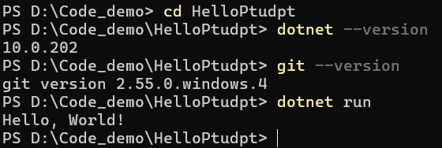
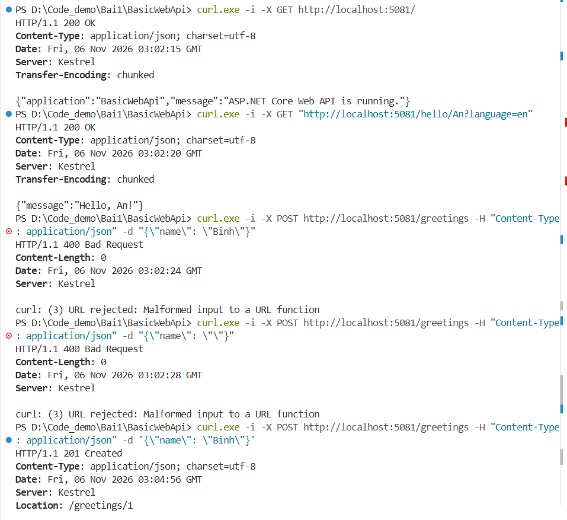
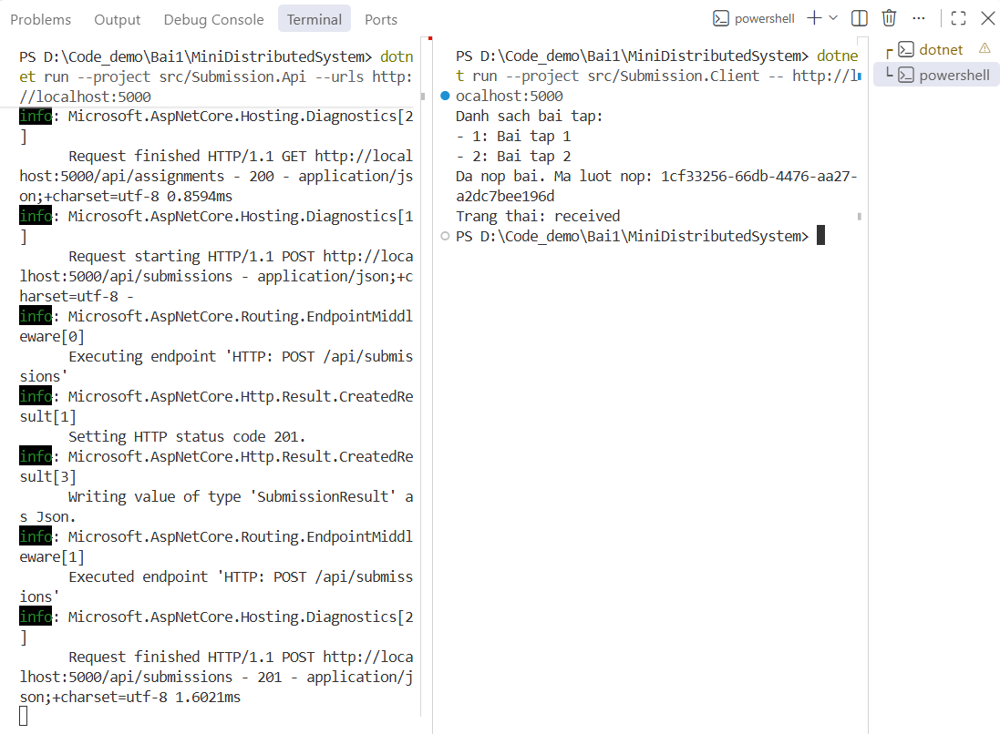
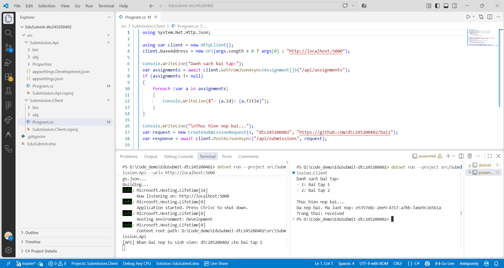
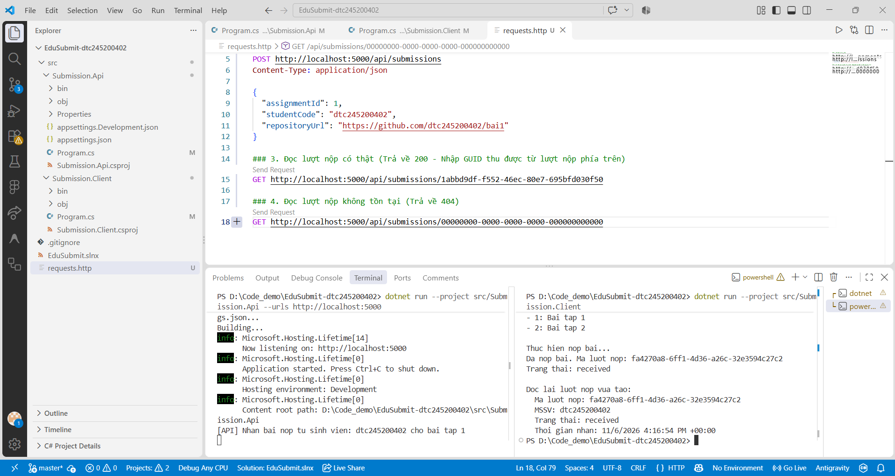

6# Bài 1 – Tổng quan hệ thống và MEP
Họ tên: Vũ Duy Linh        MSSV: dtc245200402        Lớp: CNTTK23D

## 1. Cài đặt

## 2. MepDemo (Bước 7)
- (1) Mỗi bài nộp sub-x chỉ được 1 worker xử lý.
- (2) Sự kiện được gửi tới tất cả dịch vụ đã đăng ký.
- (3) Mô tả các MEP:
  - Request-Response: Client gửi request và chờ Server trả response đồng bộ.
  - One-Way (Fire-and-Forget): Client gửi thông điệp rồi bỏ qua, không chờ phản hồi.
  - Queue: Thông điệp vào hàng đợi và chỉ 1 worker xử lý.
  - Publish-Subscribe: Publisher phát sự kiện, tất cả Subscriber đều nhận được.
  - Streaming / RPC: Truyền luồng dữ liệu liên tục hoặc gọi hàm từ xa.

## 3. BasicWebApi (Bước 8)
- Ảnh chụp REST Client (200, 201, 400):

- (1) Dòng builder.Services.AddSingleton... phải đứng trước vì toàn bộ dịch vụ (services) phải được đăng ký xong trước khi gọi builder.Build() để chốt và khởi tạo ứng dụng.
- (2) Nguồn tham số: name lấy từ đường dẫn URL (Route parameter). language lấy từ chuỗi truy vấn sau dấu ? (Query parameter).
- (3) Vì request POST dùng để tạo dữ liệu mới. Mã 201 (Created) đúng chuẩn HTTP cho việc "đã tạo tài nguyên thành công", trong khi 200 (OK) chỉ mang ý nghĩa thành công chung chung.

## 4. MiniDistributedSystem (Bước 9)
- Ảnh chụp 2 terminal API + Client:

- (1) Client gọi hai endpoint của API bao gồm: phương thức GET tới /api/assignments để nhận về mã 200 (OK), và phương thức POST tới /api/submissions để nhận về mã 201 (Created) hoặc 400 (Bad Request).
- (2) Tham chiếu code: Không dùng chung code. Hai bên thống nhất với nhau bằng hợp đồng API (API Contract): thông qua định dạng dữ liệu JSON và giao thức HTTP.
- (3) Truyền địa chỉ qua tham số: Để linh hoạt khi triển khai. Giúp dễ dàng thay đổi địa chỉ API khi đổi môi trường (từ máy cá nhân lên server thật) mà không cần phải sửa code hay build lại dự án.

## 5. Thí nghiệm lỗi (Bước 10)
| # | Dự đoán | Thực tế | Đúng Sai | Giải thích |
|---|---|---|---|---|
| a | Client sẽ thấy bài tập thứ ba mà không cần sửa code | Client in đủ `Bai tap 1`, `Bai tap 2`, `Bai tap 3`, sau đó vẫn nộp bài thành công và nhận trạng thái `received`. | Đúng | Client đọc mảng JSON do API trả về nên không phụ thuộc số phần tử cố định. |
| b | Client báo lỗi kết nối vì không có tiến trình lắng nghe ở cổng API. | Xuất hiện `HttpRequestException` và `SocketException (10061)`: `No connection could be made because the target machine actively refused it (localhost:5000)`. | Đúng | Khi API đã tắt, không còn tiến trình lắng nghe ở cổng 5000. Gọi qua mạng phụ thuộc tiến trình và kết nối bên ngoài, còn gọi hàm nội bộ thì không. |
| c | API trả 400; `EnsureSuccessStatusCode()` ném ngoại lệ. | API ghi nhận POST trả `400 Bad Request`; Client ném `HttpRequestException: Response status code does not indicate success: 400` tại `EnsureSuccessStatusCode()`. | Đúng | `StudentCode` rỗng là dữ liệu không hợp lệ. Máy chủ phải tự kiểm tra vì dữ liệu do Client gửi lên không đáng tin cậy. |
| d | Client gọi cổng 5000 sẽ lỗi khi API chạy ở 5050; truyền URL 5050 khi chạy client sẽ sửa được mà không đổi code. | Khi Client gọi 5000, kết nối bị từ chối với lỗi 10061. Chạy lại Client với tham số `http://localhost:5050` thì lấy được danh sách bài tập, nộp bài thành công và nhận `received`. | Đúng | Địa chỉ API được cấu hình qua đối số dòng lệnh nên chỉ cần truyền đúng cổng 5050, không phải sửa hoặc biên dịch lại code. |

## 6. Dự án EduSubmit tự làm (Bước 11-12)
Kết quả kiểm thử: solution build thành công với 0 warning và 0 error. Client lấy được hai bài tập, tạo lượt nộp mới, nhận trạng thái `received` và đọc lại đúng lượt nộp vừa tạo. Request thiếu dữ liệu trả 400; ID không tồn tại trả 404.

Phần đã xem code mẫu: khi tự viết, dự án được làm theo đặc tả Bước 11. Sau khi hoàn thành, có đối chiếu với MiniDistributedSystem về ba record dữ liệu và luồng gọi `GET /api/assignments`, `POST /api/submissions`.


Luồng thông điệp:
```text
Client --(HTTP GET /api/assignments)---------> API : request-response
Client <--(200 + danh sách bài tập)----------- API

Client --(HTTP POST /api/submissions + JSON)--> API : request-response
Client <--(201 + Location + lượt nộp)--------- API

Client --(HTTP GET /api/submissions/{id})-----> API : request-response
Client <--(200 + lượt nộp hoặc 404)----------- API

Phần mở rộng đã thực hiện:
- API lưu các lượt nộp trong List<SubmissionResult>.
- API hỗ trợ GET /api/submissions/{id:guid} với phản hồi 200 hoặc 404.
- Client đọc lại lượt nộp vừa tạo và in thông tin ra terminal.
- requests.http có request đọc ID thật và ID không tồn tại.
 
## 7. Khó khăn gặp phải và cách giải quyết

- **Khó khăn 1:** Khi mới khởi tạo dự án, file `Program.cs` ở cả API và Client đều chứa đoạn mã template mặc định (`Hello World!`), dẫn đến việc chạy thử nghiệm không đúng theo các endpoint yêu cầu của Bước 12.
  - **Cách giải quyết:** Xóa toàn bộ nội dung template mặc định trong 2 file `Program.cs`, thay thế bằng mã nguồn chuẩn của Minimal API và HttpClient, sau đó lưu lại file (`Ctrl + S`) trước khi thực hiện lệnh `dotnet run`.

- **Khó khăn 2:** Khi thực hiện kiểm thử endpoint `GET /api/submissions/{id:guid}` trong `requests.http`, ban đầu nhận phản hồi `404 Not Found` do dùng mã GUID cố định chưa có trong danh sách lưu tạm (`List<SubmissionResult>`).
  - **Cách giải quyết:** Chạy lượt nộp bài từ Client hoặc gửi request `POST /api/submissions` trước để API sinh ra một mã GUID thực tế. Sau đó lấy mã GUID này dán vào URL `GET` để kiểm thử thành công trạng thái `200 OK`.
